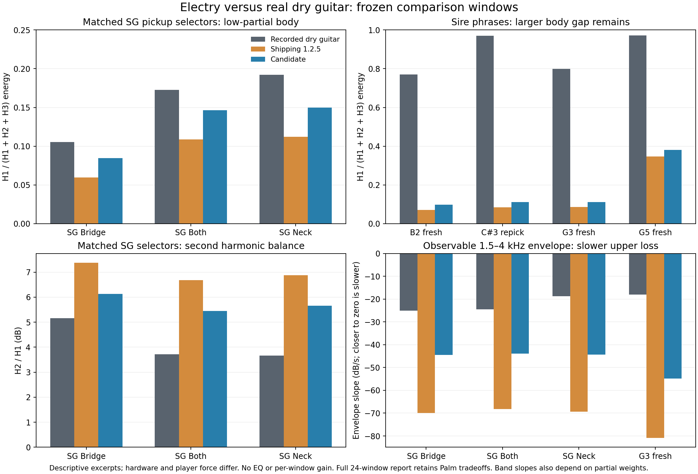

# Dry body and upper sustain validation

This continues the frozen comparison against shipping `3df6a10` (1.2.5).
The scope is Electry's shared DSP and plug-in, version 1.2.6. The Reason
embedding pin and package are separate work. The user's standing autonomous
candidate instruction supplies engineering selection; there is no new human
listening vote.

## Mechanisms

The ordinary modal release uses a standard second-order Bessel projection.
Unit DC area and the existing two-real-pole source's DC group delay determine
its normalization. It adds no amplitude makeup or fitted bass shelf. The
tail uses the actual digital pole decay under the existing truncation budget.
The source test independently observes the finite pulse, first moment,
frequency response, tail and compound-contact paths. Equal area and mean
latency do not imply equal peak or energy.

The upper-string loss correction references the existing fresh-string loss
law. A bounded two-pole low shelf replaces its curvature between the same
fundamental and 3.6 kHz traversal anchors; the legacy age and hand increments
remain. Strings 0 and 1 retain their existing material-loss path. A continuous
affine correction depth is limited using the exact extrema of a cubic in
cosine, before any temporary hand-dip attenuation. Thus relaxing that hand
cannot invalidate the certificate. Invalid bilinear coordinates or a
non-Schur denominator bypass and clear only the correction's three histories.
This establishes the scoped fixed-filter magnitude bound and stable poles;
it is not a proof for the complete time-varying instrument or coupled bridge.
At full correction the original traversal anchors match. Reduced affine depth
can add small anchor loss. The final 7,776-loop grid contains 5,832 active
eligible cases, 105 limited cases, minimum depth 0.562069 and no hard fallbacks.
Its maximum changes in nominal traversal-to-T60 mapping are 0.390349% at the
fundamental and 2.10967% at the upper anchor. Actual pole T60 additionally
depends on complete-loop group delay; exact modal-anchor equality is not claimed.

A small picked fret handoff retains each endpoint's actual raw tap and full
running feedback-filter bank. A queued destination cannot refit an already
audible bank. When a slide or hammer interrupts that queue, it adopts the
heard bank and performed geometry before deriving the next trajectory.
Expression follows owned physical-period coordinates and each bank's phase.
No ring buffer is duplicated. Ordinary stopped-string repicks open the old
stop with C2 endpoints over the existing Contact clock.

Palm keeps its established arriving hand-opening behavior and the qualified
Bessel projection. Finite
opening removed a returning unmute packet, but the unchanged processed
rapid-Palm body rail then failed. Removing the Palm pick-position coupling
made it worse; an equal-area, equal-mean-latency one-pole source passed that
one rail but failed nine other Palm behavior checks. Rolling the Palm source
back to its old projection also failed a fresh-note contrast check against
the new ordinary source. Withhold those changes
rather than manufacture compensating high-frequency energy. The old Palm
packet remains a known limitation, not evidence of improved guitar body.

## Comparison method

Four recorded Guitar-TECHS phrases retain fourteen registered attacks and
ten held windows. Seven isolated recordings add fourteen held windows,
including matched EG-IPT SG pickup selectors. Model A and B use identical
events, controls and seed; the integer crop comes from shipping A. Each full
clip receives one constant RMS gain with shared peak headroom. There is no
EQ, per-note gain, time warp, denoising, or candidate onset realignment.

All 24 low-partial windows and all pre-admitted upper-envelope frames remain.
Candidate guard failures cannot change the mask. Background/leakage margins,
alternate taper agreement and minimum slope span are observability guards,
not perceptual thresholds. Band-envelope changes also depend on initial
partial weights; the independent complex-pole audit separately measures
intrinsic loss. The complete-source tone snapshots retain every numerical
tolerance and behavioral rail, including the old full-velocity peak ceiling.

## Remaining limits

The reference hardware, force, tuning, gauge and stopping hand are incompletely
matched. P3 uses lighter strings; P1 uses flatwounds; the SG selectors are
documented but its construction and force are not. These are actual dry-guitar
comparisons, not an identified eight-string calibration. The Sire fundamental
share remains much larger than the model's. A single global bass boost would
not reconcile that corpus with the much closer SG controls.

The retained instantaneous 0.28 large-jump choke still creates a packet in the
spatial/Faraday observation path. Extending the filter-bank fade to those jumps
did not improve both worst witnesses, so that prototype was rejected. Raw and
whole-file-matched rapid-play increases remain in the report; this change does
not claim every transient becomes smaller or every old artifact is removed.
The fixed-tap handoff's midpoint cancellation also remains.

## Qualified result

Select source `46f4a49127c53e148ef83f88000e1495f8e2a068` against unchanged
shipping `3df6a10b77b8bee0c04ab20bda34b28b81f2ec84`. Later documentation commits
retain the same DSP bytes. The [validation receipt](tone-body-2026-10-18.json)
binds every source member, compiler, room manifest, observer result and local
test log. The [tone snapshot receipt](tone-source-snapshots-2026-10-18.json)
independently confirms the final source with the shelf on and off.

| Held low-partial body | Recording | Shipping A | Candidate B |
| --- | ---: | ---: | ---: |
| SG E2 Bridge | 0.1055 | 0.0596 | 0.0846 |
| SG E2 Both | 0.1728 | 0.1088 | 0.1466 |
| SG E2 Neck | 0.1922 | 0.1119 | 0.1498 |
| P3 fresh B2 | 0.7702 | 0.0711 | 0.0974 |
| P3 C#3 repick | 0.9705 | 0.0835 | 0.1118 |
| P3 fresh G3 | 0.7988 | 0.0867 | 0.1108 |
| P3 fresh G5 | 0.9725 | 0.3473 | 0.3808 |

These values are H1/(H1+H2+H3) energy, not an absolute level or population
score. H1-share error improves in 23/24 frozen windows; H2/H1 and H3/H1 errors
each improve in 22/24. The late P1 Palm window is a real tradeoff: reference
0.3510, A 0.3503, B 0.4281. No candidate observability guard fails. Five of six
admitted upper-band slopes move closer; the P1 F2 4–8 kHz slope worsens from
−106.2 to −111.8 dB/s against the recording's −21.1 dB/s.

The SG 1.5–4 kHz slopes move from about −69 to −44 dB/s, toward recorded
−19 to −25 dB/s. The G3 phrase moves from −80.9 to −54.9 dB/s versus −18.0.
The independent isolated-loop oracle also finds longer upper-mode pole T60s;
the envelope comparison alone does not establish those modal constants.

All fourteen real-phrase primary raw steps are smaller (B/A 0.810–0.951),
but whole-file matching makes some larger (0.825–1.124), and matched >8 kHz
energy rises by up to 1.88 dB in those primary windows. Wider 20–80 ms windows
include a 5.17 dB increase, partly reflecting the intended upper sustain.
Across the six rapid controls, raw primary step ratio reaches 1.641 and raw
>8 kHz RMS increases by 3.405 dB in the retained large-jump witness. Every
onset and all three fixed windows remain; these are not universal transient
improvements. Raw whole-crop RMS across real-reference cases is 0.844–1.007
times A. No output makeup is applied.

## Verification and runtime

The final source passes all **41 unit suites**, the **audio tier**, and four
targeted ASan/UBSan/float-cast-overflow suites: loss shelf, modal release,
stopping-hand restoration and refret. The C++17 embedded DSP target builds
with exceptions and RTTI disabled. Final snapshot observers reproduce all
29 measured values exactly from the earlier combined source; full Engine
passes with the shelf on and off, and the pickup fixtures pass on ARM and
x86_64. Numeric tolerances, pickup contrast, dynamics, tuning, Palm and
portable CPU guards are unchanged. PR and main CI are additional merge gates.

The scoped Palm test matches the qualified source-only tone's 66,138 dry and
66,138 processed samples, plus 268 complete source/ring/pickup-history
observations, exactly with unrelated new features disabled. It does not claim
identity to shipping's intentionally different source projection.

Three paired native timing rounds compare exact source 46f4 with shipping.
Memory grows by 13,056 bytes per engine (25.5 KiB for two). Median steady
eight-string CPU cost rises 2–8%; active handoff rendering rises 1–5%, with
two actual source banks verified in every measured handoff. Moving pressure
is more expensive. At 384 kHz its median p95 is 0.683 ms against a 0.667 ms
256-frame budget; one 96 kHz worst observation also exceeds its block budget.
Concurrent load is recorded. These measurements establish a cost and a
limitation, not an absolute real-time guarantee. The fixed-filter solver stays
uncached so no new invalidation assumptions are introduced here.

The new room is **http://127.0.0.1:8726/**, with separate recorded phrases,
isolated notes, rapid scores and mechanism keys. All older rooms and rejected
prototype evidence remain frozen. The [research record](../research/tone-body-2026-10-18.md)
contains the experiment comparisons and their limits.
