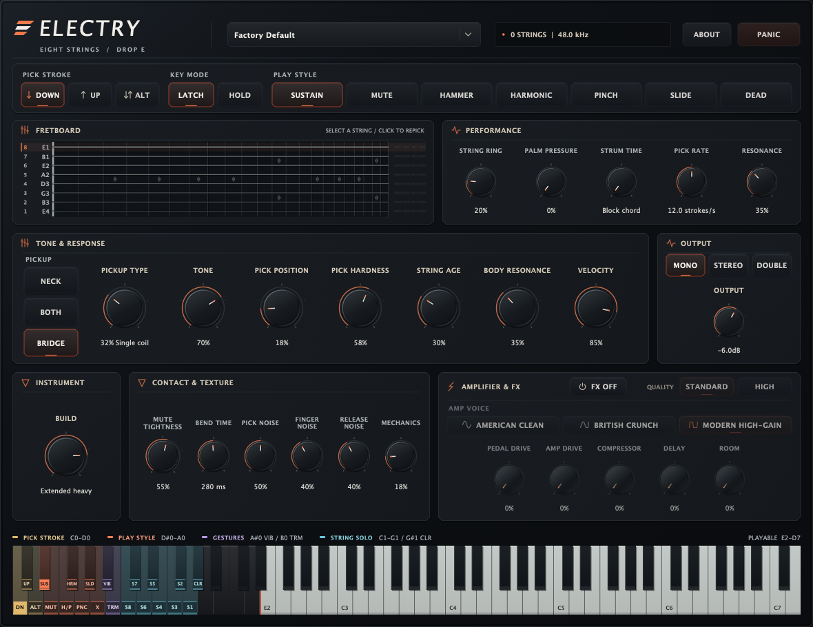

# Electry

An original, physically modeled **eight-string electric guitar**: VST3, Audio
Unit, CLAP and standalone for macOS, Windows and Linux. Play a dry DI or use
the built-in amps and effects, with palm muting, hammer-ons, slides, harmonics
and vibrato.

**[Download the latest build](#downloads)** · [Audio demos](#audio-demos) · [Version history](#version-history) · [How it works](#how-it-works)



## Audio demos

One phrase per factory rig, played through the plug-in processor from
[`Docs/audio/midi/`](Docs/audio/midi) with the rig loaded. Drop-E Metal and
Blues Rock Lead play with **FX** on, the other two as a dry DI.

<!-- audio-demos-begin -->

| # | Preset | Demo | Length | Peak |
| --- | --- | --- | --- | --- |
| 1 | Factory Default | [01-factory-default.mp3](Docs/audio/01-factory-default.mp3) | 19.1 s | -18.9 dBFS |
| 2 | Drop-E Metal | [02-drop-e-metal.mp3](Docs/audio/02-drop-e-metal.mp3) | 13.6 s | -12.9 dBFS |
| 3 | Mute / Dead DI | [03-mute-dead-di.mp3](Docs/audio/03-mute-dead-di.mp3) | 14.5 s | -6.4 dBFS |
| 4 | Blues Rock Lead | [04-blues-rock-lead.mp3](Docs/audio/04-blues-rock-lead.mp3) | 13.0 s | -9.7 dBFS |

<!-- audio-demos-end -->

### More demos

[Dry rhythm](Docs/audio/04-drop-e-rhythm-dry.wav)
· [Amplified rhythm](Docs/audio/05-drop-e-rhythm-amp.wav)
· [Lead showcase](Docs/audio/17-extended-technique-solo.wav)
· [Three amp voices](Docs/audio/23-amp-voices.wav)
· [All 23 demos](Docs/audio)

Start with **Factory Default** for dry DI, **Drop-E Metal** for heavy rhythm,
or **Blues Rock Lead** for a lead with amp, delay and room.
FX starts **off**; click **FX OFF** to enable the selected rig's effects.
See [factory rigs and quick start](#factory-rigs-and-quick-start) for playing
instructions; the notes below are the full listening guide.

Twenty-three takes, rendered by [`Tools/RenderDemos.cpp`](Tools/RenderDemos.cpp)
from the same JUCE-free code the plug-in runs: the full playable range, every
pick-stroke and play style, dry and amplified rhythm, lead tone, pickup and
tone contrasts, sympathetic strum, guitar-build contrasts, velocity dynamics,
power chords, a long arrangement, the pitch-bend and feedback wheels, a focused
dry Sustain/Mute/Dead audition, a matched high-gain Mute/Dead comparison, an
extended all-technique solo, four original genre studies, a tremolo-picking
study and one globally normalised three-amp comparison. They are
demonstrations, not evidence — an audible example is not a measurement, and
none of the claims below rest on them. The reproducible ten-probe model renderer,
real-recording boundaries and blind-study plan live in the
[`evaluation contract`](Docs/research/evaluation.md).

<!-- peaks-table-begin: regenerated by ElectryRenderDemos; edits between the markers are overwritten -->
| File | Rendered peak | Normalisation applied |
| --- | --- | --- |
| `01-range-open-strings.wav` | −14.7 dBFS | +11.7 dB |
| `02-range-full-fretboard.wav` | −15.5 dBFS | +12.5 dB |
| `03-play-styles.wav` | −18.8 dBFS | +15.8 dB |
| `04-drop-e-rhythm-dry.wav` | −10.4 dBFS | +7.4 dB |
| `05-drop-e-rhythm-amp.wav` | −13.1 dBFS | +10.1 dB |
| `06-lead-amp-delay-room.wav` | −11.9 dBFS | +8.9 dB |
| `07-pickups-and-tone.wav` | −15.2 dBFS | +12.2 dB |
| `08-sympathetic-strum-stereo.wav` | −17.3 dBFS | +14.3 dB |
| `09-guitar-build-contrasts.wav` | −12.3 dBFS | +9.3 dB |
| `10-velocity-dynamics.wav` | −15.4 dBFS | +12.4 dB |
| `11-power-chords-dry.wav` | −9.8 dBFS | +6.8 dB |
| `12-power-chords-amp.wav` | −12.6 dBFS | +9.6 dB |
| `13-long-rhythm-arrangement.wav` | −13.2 dBFS | +10.2 dB |
| `14-whammy-and-feedback.wav` | −12.7 dBFS | +9.7 dB |
| `15-mute-and-dead-audition.wav` | −13.5 dBFS | +10.5 dB |
| `16-mute-and-dead-metal.wav` | −13.5 dBFS | +10.5 dB |
| `17-extended-technique-solo.wav` | −12.2 dBFS | +9.2 dB |
| `18-syncopated-djent-study.wav` | −12.2 dBFS | +9.2 dB |
| `19-modern-metalcore-study.wav` | −11.9 dBFS | +8.9 dB |
| `20-odd-meter-prog-study.wav` | −6.8 dBFS | +3.8 dB |
| `21-blues-rock-lead-study.wav` | −10.1 dBFS | +7.1 dB |
| `22-tremolo-picking-study.wav` | −12.8 dBFS | +9.8 dB |
| `23-amp-voices.wav` | −14.0 dBFS | +11.0 dB |
<!-- peaks-table-end -->

`15-mute-and-dead-audition.wav` is the quickest dry vocabulary check: the same
E1 as Sustain, three Mute Tightness depths, a Palm-held E1/E2 octave whose low
string hammers and pulls without lifting the bridge hand, then fretting-hand
Dead and playable alternate ghost grooves. `16-mute-and-dead-metal.wav` keeps
the score and high-gain chain fixed between Mute and Dead. Double belongs to the
plug-in wrapper and is not used by these JUCE-free single-engine renders.

`17-extended-technique-solo.wav` is the longer lead showcase: two shred runs,
two distinct vibrato holds, ascending hammer-ons and descending pull-offs,
slides in both directions, a final descending slide redirected continuously
before its first target, and all seven play styles in one performance. The next
four files translate the requested reference points into broad, original genre
vocabularies rather than copying a composition, riff or production:

- `18-syncopated-djent-study.wav`: Periphery-adjacent extended-range traits —
  displaced Drop-E accents, tight chugs, dead punctuation and a tapped answer.
- `19-modern-metalcore-study.wav`: Bring Me the Horizon-adjacent traits — an
  anthemic power-chord hook, simple high melody and half-time breakdown.
- `20-odd-meter-prog-study.wav`: Dream Theater-adjacent traits — clean
  arpeggios, seven- and five-beat groupings and a virtuoso alternate-picked run.
- `21-blues-rock-lead-study.wav`: Joe Bonamassa-adjacent traits — a dynamic
  neck-pickup lead with slides, legato, bends, a pinch and sustained vibrato.

`22-tremolo-picking-study.wav` is the playable black/progressive-metal repeat
proof: the visible B0 **TRM** wrist runs the ordinary physical attack path at
8, 12 and 16 strokes/s, enters a moving line after being held in silence,
then pre-holds A#0 through a 240 ms rest so the next stopped finger demonstrates
a fresh vibrato bloom. That lead picks MIDI 74, genuinely hammers to 76, then
leaves Hammer latched while B0 continues making picked Sustain contacts before
Sustain is restored. A held Drop-E chord follows, with its low string sliding
while a scheduled repeat is still travelling toward it. The played entrance
becomes the wrist's first contact, so its next pick is one complete interval
later; every repick leaves the rocking fretting finger in place, and the slide
retargets the reserved low-string contact to the moving fret without stealing
the stroke from the other strings. Those three anchors equal sixteenth notes at
120, 180 and 240 BPM.

`23-amp-voices.wav` sends the same deterministic Drop-E performance through
three fresh FX instances in order: American Clean, British Crunch and Modern
High-Gain. Amp remains at 90%, every other performance and FX setting is held
fixed, each segment has the same duration, and one gain is applied to the whole
file. Near-legato overloaded chord turns expose each circuit's short-term grid
recovery before the phrase moves through chugs, a ringing chord and a bent,
vibrato lead. This compares response and nonlinear dynamics rather than a
level-matched succession of unrelated presets. Existing amplified demos 05–22
continue to use that same Modern topology and voicing.

Files 18–22 are original Electry studies, not endorsements or artist
sound-alikes.
The finger-vibrato moments in files 06, 17, 21 and 22 use the same model available
from the visible A#0 **VIB** key. Hold it before or while a physically held
stopped note rings; pre-held intent waits for the finger to land, and velocity
chooses width. Channel and polyphonic pressure remain unassigned, so normal
aftertouch cannot bend a chord by surprise. MPE currently maps its pitch
dimension only; per-note pressure, CC 74 timbre and Note Off velocity await a
capture- and listening-calibrated physical mapping.

## Version history

No tagged release has been published yet: every build so far is a development
build from `main`. Per-change notes are in the
[development checkpoints](Docs/research/development-checkpoints.md).

### 1.2.5 — In development — Smoother fret handoffs

Picked fret changes use a smoother two-tap fade to spend less time in the
handoff's cancellation region, keeping the existing Contact duration and
stationary pitch endpoints. Repeated picks retain their existing attack.
The remaining midpoint comb notch and hardware-dependent dry-guitar tone
differences are documented in the
[coloration analysis and comparisons](Docs/validation/refret-coloration-2026-10-18.md).

### 1.2.4 — In development — Picked fret transitions

Small picked changes on a ringing string hand off between stationary old- and
new-fret feedback taps, avoiding the unintended pitch sweep from the bend
follower. The handoff retains string, filter and pickup history, with no output
fade or new timing control. Interrupted changes finish their current handoff
before moving to the latest destination. Large jumps retain their existing
choke, including net jumps across unheard same-clock intermediate frets.
Wheel, MPE and vibrato keep their continuous smoothing at both endpoints.
A queued pick retains the preceding Contact's complete wrist state until
arrival, including when a new MPE member takes the same pitch.
See the [fret-handoff validation](Docs/validation/refret-handoff-2026-10-18.md)
for real DI comparisons and the method's limits.

### 1.2.3 — In development — Same-string note handoffs

An older MIDI Note Off no longer stops a newer note after an A → B → A
passage on the same string. Displaced MIDI owners are retained until their
matching ends arrive, so overlapping riffs and repeated notes keep their
intended sustain. Picking-hand repick keys retain their separate ownership.
See the [real DI comparisons and validation](Docs/validation/performance-realism-2026-10-18.md).

### 1.2.2 — In development — String mass, modal fitting and continuous legato

Hammer-ons and slides retain their continuous stiffness fit when the finger
reaches its destination, avoiding a global coefficient jump on a ringing
string. Wound strings now use published XL reference masses for their light
gauges; the heavier gauge morph remains an explicit geometric-similarity
hypothesis. The selected dispersion fitter scores stretched modes rather than
two harmonic anchors; cached trigonometry bounds its extra setup cost.
Saved patches use canonical parameter values so restoring a factory rig
preserves its serialized state exactly without altering live controls.
No release package has been published for this development work.

### 1.2.1 — 2026-10-17 — Click-free bends and slides

Bends, vibrato and slides on a ringing string no longer squeal: the string's
stiffness fit now moves smoothly with its pitch. The editor's **ABOUT** button
shows the version and build. The vendor is now **Protocodus** with the bundle
and CLAP ID `cz.protocodus.electry`; on macOS reinstall over the old build, and
re-insert Electry in CLAP sessions saved with an earlier build.

### 1.2.0 — 2026-10-16 — String voicing, realism corrections and release hardening

Notes prefer unused strings and the lowest fret; picked attacks, sympathetic
strings and low-note sustain are more realistic; malformed host input is
handled safely. The black-metal interface, FX bypass and automated
distribution builds arrived during 1.2.0 development.
[Release notes](Docs/release/release-notes-1.2.0.md).

## Downloads

<!-- build-download-begin -->
**[Download main build 82](https://github.com/protocodus/virtual-instrument-electry/actions/runs/39230241935/artifacts/12177388980)**, built from [`f077fbbe0a21`](https://github.com/protocodus/virtual-instrument-electry/commit/f077fbbe0a2170df947193f95ca471e2c5b47727). It holds the macOS, Windows and Linux packages, `SHA256SUMS` and `BUILD.txt`.
<!-- build-download-end -->

This link downloads the complete binary package set, including the plug-ins and
standalone applications below. GitHub requires sign-in to download workflow
artifacts. Successful builds refresh this link automatically. You can also find
`electry-main-build-<build number>` in the **Artifacts** section of
**[successful Main builds](https://github.com/protocodus/virtual-instrument-electry/actions/workflows/main-build.yml?query=branch%3Amain+is%3Asuccess)**
(older runs use `electry-main-build`).

| Platform | Formats | Package |
| --- | --- | --- |
| macOS — Apple Silicon + Intel | VST3, Audio Unit, CLAP, standalone | Universal ZIP and PKG installer |
| Windows — x64 | VST3, CLAP, standalone | ZIP |
| Linux — x64 | VST3, CLAP, standalone | tar.gz |

Every merge to `main` rebuilds the distributions, screenshot and all 23 audio
demos. Each download includes that complete set, source revision and SHA-256
checksums, and remains available for 30 days. Builds also refresh daily.
Package filenames include the workflow run number, for example
`Electry-1.2.1-build.70-macOS-universal.pkg`; the Windows ZIP, Linux tarball and
macOS ZIP use the same version and build number. `BUILD.txt` records the build
number and source commit inside the combined download.

macOS bundles are ad-hoc signed; the PKG installer is unsigned and the builds
are not notarized. Audio Unit is available only on macOS.

---

## How it works

[Build from source](#build) · [MIDI and playing controls](#how-it-works)
· [Host parameters](#30-host-parameters) · [Sound architecture](#sound-architecture)
· [References](#references-and-claim-boundaries) · [Known gaps](#known-gaps)
· [Licensing](#licensing)

### Instrument model

Eight string voices run dual-polarisation waveguide loops with physically
derived stiffness dispersion, decay-targeted damping and exact fundamental
phase compensation. A fretting hand with a position and a reach decides where each
note is played; a point-touch model produces natural and pinch harmonics as the
string's own mode shapes rather than as transpositions; slides are a distance
over a hand speed, their squeak the winding passing under the finger; a picking
hand never puts the plectrum down in exactly the same place twice. Without an
MPE zone, the standard pitch wheel moves every string together over a uniform
±2 semitone range. Once a valid MIDI MPE zone and its pitch ranges are
declared, each member channel owns a physical string and bends only that
performed note while the zone master adds a chord-wide interval. A resonance
wheel can push a distorted tone into self-sustaining amplifier
feedback through a fixed nominal air delay, independent of DAW callback size,
with performance-controlled idle-string drive. One bridge is shared by all
eight strings:
the ones you are not fingering ring off it, and the ones you are exchange
energy through it. The pickups follow a published signal structure — position
comb, two coils for the humbucker and one for the single coil, finite magnetic
aperture, nonlinear flux, induced EMF and loaded coil resonance.

The performance is selected with two independent keyswitch banks below the
playable range. Pick Stroke always latches; Play Style can either latch or act
only while its key is held, then return to the visible base choice. Any stroke
can therefore drive any style without programming an Open switch around every
muted phrase.

The FX panel provides a global **FX ON / FX OFF** toggle, five amount controls, an **Amp Voice**
selector and **Standard / High Quality**: a distortion pedal; American
Clean, British Crunch and Modern High-Gain amplifier/cabinet paths; compression;
lead delay; and a stereo room.
New instances start with FX off. Bypass preserves the dry guitar and all stored
FX settings, dims the effect controls, and switches with a 5 ms crossfade.
Older saved sessions without the toggle retain their enabled effects.
Every amount defaults to a true 0 % dry setting. Once Distortion or Amp is moved
above zero it is a drive control around a fully connected circuit, so no
uncabbed DI leaks around an enabled loudspeaker. A prepared inverse table
solves the pedal's antiparallel-diode RC step while retaining its capacitor
history; accurate scalar tables reduce the phase inverter's repeated math.
All three amplifiers use dense measured-12AX7 plate-load transfers generated from exact circuit
solves; the American and British paths add exact third-order passive RC tone
stacks, measured-curve-fitted 6L6GC beam-tetrode or EL34 pentode push-pull load
lines, and source-derived nonlinear 12AT7/ECC81 or ECC83 long-tailed-pair phase
splitters. Two independently solved output-coupling, grid-return and stopper
branches add power-grid conduction, blocking memory and common-bias recovery.
The power-tube load lines also solve their source-derived screen resistors:
individual 470 Ohm American branches and one common 800 Ohm British branch.
Negative feedback, plate-plus-screen-current-driven sag, transformer flux and
six-section speaker/cabinet voicing complete each path. The Modern path retains
Electry's established metal circuit topology and voicing.
The nonlinear blocks use **Standard** oversampling by default: 4× at 44.1/48
kHz. **High** retains the previous 8× rate at those rates and stronger alias
suppression. Both adapt at higher host rates. Standard lowers processing cost
with an accepted increase in high-drive aliasing; High retains the original
antialiasing target.
These are meticulously bounded circuit-derived families, not capture-accurate
replicas of named amplifiers, individual power-tube specimens, microphones or
rooms. Mono is the
authentic summed dry DI; Stereo is one engine's
phase-coherent divided-pickup view of the eight physical strings; Double is two
separately seeded deterministic Electry performances, one per channel, with
independent contact detail and a bounded 0-6 ms second-player pick clock.
Neither stereo choice is a delayed copy or synthetic widening effect.
The shipping Guitar Build control moves the supported walnut-to-ash material
coordinate through three paired pickup-observed modes while visiting six
distinct 25.5-to-28-inch light/heavy string setups. Unsupported size, shape and
joint coordinates remain neutral; the scale/gauge path is explicit voicing, not
a claim that material determines either one. The former four-mode construction
path remains available only as an explicit legacy comparator.
Pickup construction, selector, tone, body-colour amount and all player controls
remain independent.

Every model has named research references, listed below. Electry does not claim
to be a capture-accurate clone of any one instrument.

### Factory rigs and quick start

The editor's preset selector provides four deterministic starting points and
sets the 29 tone and performance parameters. Rigs preserve the global FX
toggle, Pick Stroke, the base Play Style and the `LATCH | HOLD` choice.
Compact knob captions remain short enough for the faceplate, while each knob's
accessibility title uses its complete host parameter name (for example,
**Mute pressure**, **Compressor** and **Output level**).

- **Factory Default:** the dry Drop-E guitar documented in the parameter table.
- **Drop-E Metal:** the demonstrated 45% distortion / 95% Modern High-Gain amp /
  60% compressor chain and tight rhythm setup used by the matched Mute/Dead
  demo.
- **Mute / Dead DI:** dry, +6 dB, hard near-bridge pick, no sympathetic ring
  and middle Mute Tightness, exposing the two hand contacts without an amp.
- **Blues Rock Lead:** the host-loadable version of the warm neck-pickup Stereo
  voicing behind `21-blues-rock-lead-study.wav`, with responsive 150 ms bends,
  moderate Modern amp drive, compression, delay and room. Its +3.2 dB output is
  the host control's nearest 0.1 dB step to the demo renderer's 1.45 gain.

1. Load **Drop-E Metal**, click **FX OFF** so it reads **FX ON**, and play E1..D6
   (MIDI notes 28..86), the full range drawn on the on-screen piano.
   C0/C#0/D0 select Down, Up or Alternate picking.
2. Keep a note or chord held and click its row in the live fretboard for one
   hard repick without releasing the fretting key. The visible 8..1 column
   uses the same physical-string order as the number keys. Velocity-sensitive
   host or controller playing uses MIDI E6..B6 for physical strings 8..1; those
   performance triggers are not drawn as misleading pitched piano keys. If
   Hammer is latched, these dedicated picking-hand commands still make a
   neutral Sustain pick contact and leave the latch ready for the next note.
3. Select E0 **Mute** for chugs. **Mute Tightness** is the articulation's
   loose-to-tight steady bridge-hand loss; **Mute Pressure** and MIDI CC 2 are
   the live bridge hand and also stack on Dead. A0 **Dead** is the separate
   fretting hand.
4. Use `PLAY-STYLE KEYS: HOLD` with Sustain as the visible base to hold E0 only
   over chugs or A0 over ghosts. `LATCH` keeps the choice selected.
5. Hold A#0 **VIB** over a fretted lead note. Velocity 64 is the moderate
   roughly 5.6 Hz / 20-cent nominal gesture; velocity 127 reaches the full
   roughly 6.4 Hz / 40-cent rock arc before its bounded per-cycle variation.
   Open strings stay fixed because no finger is stopping them.
6. Hold B0 **TRM** while a note is physically held for automatic picking.
   **Pick Rate** defaults to 12 strokes/s; velocity remains pick force, and
   Alternate remains one down/up wrist. Releasing B0 stops new contacts and
   leaves the current string to decay. E6..B6 remain one-shot string triggers.
7. Choose Mono for a conventional DI, Stereo for one guitar's divided-pickup
   field, or Double before the phrase for two independently performed engines.

### Keyswitches, playable range and repick triggers

MIDI notes 24..31 are solo-string keyswitches in Octave 1 (C1..G1) corresponding to physical strings 8..1 (lowest E1 to highest E4), and note 32 (G#1) is Solo Clear (All Strings). These are prominently indicated directly on the on-screen keyboard with labels `S8` through `S1` and `CLR`, dynamically highlighted when active. When any solo string keyswitch is active (either held in HOLD mode or latched in LATCH mode), played notes and chords are voiced only on those active strings; notes outside their playable 22-fret range are ignored without sounding. Voices already sounding or decaying on unselected strings continue ringing naturally.

| MIDI note | Key | Solo string keyswitch |
| --- | --- | --- |
| 24 | C1 | Solo String 8 (low E1, open pitch 28 sounding / written 40) |
| 25 | C#1 | Solo String 7 (B1, open pitch 35 sounding / written 47) |
| 26 | D1 | Solo String 6 (E2, open pitch 40 sounding / written 52) |
| 27 | D#1 | Solo String 5 (A2, open pitch 45 sounding / written 57) |
| 28 | E1 | Solo String 4 (D3, open pitch 50 sounding / written 62) |
| 29 | F1 | Solo String 3 (G3, open pitch 55 sounding / written 67) |
| 30 | F#1 | Solo String 2 (B3, open pitch 59 sounding / written 71) |
| 31 | G1 | Solo String 1 (high E4, open pitch 64 sounding / written 76) |
| 32 | G#1 | Solo Clear (All Strings) — resets string restriction to normal polyphony |

MIDI notes 12..21 are two independent banks of silent keyswitches. Notes
12..14 (C0..D0) always latch how the pick moves. Notes 15..21 (D#0..A0) either
latch what the hands do or, in HOLD mode, override the PLAY STYLE strip's saved
base only while pressed; newest held key wins and release reveals an older held
key or the base. The two banks stay independent, so any of the twenty-one
combinations — an up-stroke Mute, alternate-picked pinch harmonics — is
reachable in at most two keyswitches. The editor and on-screen keyboard expose
both banks. A play-style release changes future attacks only: sounding
notes, delayed strums and pending repicks keep the style captured at Note On.

| MIDI note | Key | Picking style |
| --- | --- | --- |
| 12 | C0 | Down (default) |
| 13 | C#0 | Up — opposite displacement polarity, slightly closer to the bridge, thinner and brighter |
| 14 | D0 | Alternate — starts down, then alternates down/up for each accepted picked note-on; hammered notes neither take nor consume a stroke |

| MIDI note | Key | Play style |
| --- | --- | --- |
| 15 | D#0 | Sustain (default) — the ordinary ringing pick |
| 16 | E0 | Mute — damping follows Mute Tightness, from a loose half-mute to a tight metal chug at the firm end |
| 17 | F0 | Hammer-on / pull-off — continues a sounding string legato within a nine-fret reach, including pull-offs to open strings; from silence it is a tap, and in either case it has no plectrum contact or wrist delay |
| 18 | F#0 | Natural harmonic — a finger resting on the string's midpoint node, so the octave is what the string does rather than a transposition of it |
| 19 | G0 | Pinch harmonic — the picking hand's thumb catches the string at the pick's own position, so Pick Position chooses which partial squeals |
| 20 | G#0 | Slide — the finger stays down and travels without a second attack; the travel time is a distance over a hand speed, and the winding scrapes under it the whole way |
| 21 | A0 | Dead note — the fretting hand lies across the strings without pressing them to a fret; it stays a dark periodic ghost rather than a gate |

Hammer-ons, pull-offs and legato Slides have no plectrum contact. If the bridge
hand is already palm muting, those fretting gestures retain it on the moving
string and every ringing sibling; only a later real picked contact can move the
shared hand. A Hammer after Dead still replaces that fretting-hand choke.
If another Slide or Hammer arrives before a glide settles, it continues from
the pitch and fractional fret under the finger at that sample. The abandoned
destination never sounds, and direction, remaining travel and scrape speed all
follow the live hand position. Phase changes from the destination's damping and
dispersion fit are absorbed into the raw delay coordinate, so the complete loop
period—not merely its MIDI control value—stays continuous.
Live Mute Pressure and shared Palm/Open hand contacts use the same complete-loop
invariant: changing loss changes decay and colour, not the pitch of a string
that was already ringing.

| MIDI note | Key | Momentary gesture |
| --- | --- | --- |
| 22 | A#0 | Vibrato — hold while physically held stopped notes ring; Note On velocity sets the hand's width and Note Off eases it back to rest. Pre-held intent waits at zero for a stopped finger, while open strings and key-released tails stay fixed. Overlapping owners balance, All Sound Off and Reset All Controllers preserve a physically held key, while All Notes Off and Panic release it |
| 23 | B0 | Tremolo picking — hold to repick every physically held string through the current Pick Stroke and Play Style; only a latched Hammer uses a neutral Sustain contact without changing the latch. Velocity is pick force and Pick Rate is speed. A newly played note is its own first contact. Overlapping owners balance; CC120/121 preserve the held wrist, while CC123, Panic, prepare and release stop it |

Notes 33..39 (A1..D#2) are silent unmapped keys. Following standard written guitar notation convention, the playable area is written one octave above sounding pitch: notes 40..98 (E2..D7) are playable on a 22-fret, eight-string Drop-E instrument sounding as physical E1..D6 (tuned E1-B1-E2-A2-D3-G3-B3-E4). D#7 (99) is a silent separator. Notes 100..107 (E7..B7) are picking-hand triggers for physical strings 8..1, from the lowest E1 string to the highest E4 string. A trigger repicks the note physically held on that string with its own velocity and the current Pick Stroke and Play Style; only a latched Hammer becomes a neutral Sustain pick for this dedicated contact, without changing the latch or the next playable note. An unheld string stays silent. A trigger never adds fretting-key ownership, so its Note Off is inert and the original note's Note Off still releases normally. Held ownership survives the old sound's natural decay, allowing a silent Mute or Dead note to be struck again. Notes outside these ranges are ignored. The on-screen keyboard displays C0 through D7: Octave 0 houses picking/style keyswitches and gestures, Octave 1 houses solo-string keyswitches (with a visual brass nut divider at E2 = 40), and E2..D7 is the interactive playable area. E7..B7 remain available as MIDI-only performance triggers. Clicking a row in the live fretboard sends the same trigger at hard velocity; it is a visible picking-hand shortcut, while the MIDI lane retains continuous velocity and sequencer timing.
The visible B0 **TRM** key drives those same one-shot contacts from one shared
wrist clock. At the default 12 strokes/s, the first repeat is exactly 4,000
host samples after the initial contact at 48 kHz; phase remains sample-accurate
across host block partitions at every supported rate and oversampling mode.
If the wrist was already held while no string was fretted, the first played
contact re-anchors that phase instead of inheriting a nearly finished empty
cycle and creating a flam against its own next pick.
Hammer-ons and legato slides remain fretting-hand gestures: even when one lands
on the exact repeat boundary, B0 still reaches every physically held string.
Conversely, leaving Hammer latched cannot turn a B0 or E7..B7 picking-hand
command into another tap: that dedicated contact uses Sustain while the latch
remains available to the next playable note.
If that finger move arrives after a repeat has been reserved but before its
pick reaches the same string, the plectrum keeps its remaining travel time and
meets the string at its current moving pitch instead of disappearing or
finishing the glide early.
The reverse separation matters too: while a held string is still ringing, a B0
or E7..B7 plectrum contact restarts it without restarting the A#0 finger rocking
the fret. A new fretting assignment, or a contact after the damped voice has
retired, draws a new finger phase, rate and excursion.
Pre-held A#0 intent remains at zero until a physically held stopped finger
exists. A released or sustain-held tail has no fretting finger and keeps no
vibrato offset. Releasing one stopped key clears only that voice while a
still-held stopped sibling keeps the shared onset; releasing the final one
immediately zeros the onset and voice offsets without clearing A#0's target or
ownership.
A fresh refret—including an off-grid same-boundary refret or stopped-to-open-to-
stopped legato—therefore blooms from rest. Overlapping ownership of the same
held or delayed note preserves the onset already in flight.
Multiple held strings share one
stroke direction and Strum traversal. If a wide traversal is still in flight,
the next grid contact is skipped rather than replacing a pick that has not yet
reached its string. The free-running 4..20 strokes/s control avoids inventing
host-transport or pattern-editor state; DAW users can still sequence E6..B6 for
arbitrary synced rhythms.
Each playable note is allocated to one of eight physical strings. Repeated
notes keep their string and balanced MIDI ownership, MPE members retain their
physical binding, and Hammer/Slide continues an eligible sounding string.
Otherwise unused strings come first, followed by the lowest playable fret.
Release tails, sustain-held notes, pending contacts and silent held-key owners
still reserve their strings. If every playable string is reserved, the lowest
fret wins before release status and age break ties. A complete chord batch
preserves the same ownership and legato priorities, then minimizes occupied
strings and total fret height before considering hand reach and movement.
String-solo keyswitches constrain every choice to the selected strings.
The fretting hand still tracks the selected shape for gestures and
articulations: its index finger covers four further frets, it moves when the
shape lies outside its span, and it relaxes to the nut when the phrase ends.

Before a valid MPE zone is declared, pitch wheels retain the original
channel-agnostic contract: the latest wheel applies the same standard ±2
semitone bend to every played and sympathetically ringing string, so a chord
stays in tune. MIDI MPE Configuration RPNs activate lower or upper zones;
Pitch Bend Sensitivity RPN 0 then sets their member and master ranges. JUCE's
public zone layout keeps the whole-semitone part
for routing, while Electry separately retains RPN 0's Data Entry LSB so the
performed member and master ranges include their declared cents. Each member
channel then remains bound to its physical string, including two channels
playing the same pitch; its wheel uses the zone's per-note range, and the zone
master's wheel adds its declared interval to every member. Both paths travel
over Bend Time rather than snapping, and a layout change cannot orphan the Note
Off of a note that began in the preceding zone. A released string freezes only
its performed member interval while it damps; the zone master remains live for
that natural or CC 64-held tail. Member-wheel data received on the idle channel
is cached for its next finger instead of retuning the old tail. With no new
member wheel, the next finger starts centred while the zone-master bend remains
live. CC 121 recentres both wheels, nulls the current RPN/NRPN selection and
keeps the exact declared ranges; CC 123 retains Electry's historical
whole-instrument release semantics. Channel
pressure, polyphonic aftertouch, MPE CC 74 timbre and Note Off velocity remain
deliberately unassigned, so no uncalibrated message silently changes the
guitar. The modulation wheel (CC 1) is the
performance resonance: it raises the sympathetic coupling from the
Sympathetic Ring parameter toward total and opens an acoustic feedback path
from the amplified output back into the strings, scaled by the Resonance
Depth parameter — with the amp or distortion up and the wheel raised, a held
note regenerates into self-sustaining feedback, and a dry DI never can. The
amplified return crosses a sample-rate-derived 5.805 ms nominal air path
(roughly two metres at the speed of sound); causal internal chunks keep that
distance fixed at any host block size. Played strings receive the full bounded
acoustic return; idle strings retain their bridge-driven sympathetic bloom but
receive one quarter of the direct return, modeling the light unused-string
control of a high-gain performance. The
sustain pedal (CC 64) holds released strings; breath/CC 2 adds continuous
bridge-hand pressure on top of the Mute Pressure parameter. While CC 2 is above
zero, the engine status shows `CC2 MUTE +NN%`; the Mute Pressure knob remains
the independent host parameter, so remembered controller pressure cannot hide
behind a 0% knob. CC 120/123 behave as All Sound Off and All Notes Off.

### Sound architecture

- **Strings:** one voice per physical string. Each voice runs two
  single-delay-loop waveguides (the two transverse polarisations) with
  third-order Lagrange fractional delays, a one-pole damping filter solved
  from per-string decay targets, an eight-stage factored allpass dispersion
  cascade fitted at low and high partials from the string's physical
  inharmonicity (diameter, effective wound core, scale length,
  tension), and a contractive bridge coupling. The horizontal polarisation
  decays 1.7x slower and is detuned by a fraction of a cent, giving the
  natural two-stage decay and slow beating. The detune is a fixed fraction of
  the sounding period. Polarisation cross-coupling is the amplitude gain `c`
  of a memoryless, contractive two-by-two matrix at the folded-loop seam: a
  returned travelling wave encounters that matrix once per loop. Its nominal
  linear-with-`f0` voicing is now written explicitly as
  `c = 0.04 f0 / 96000`, so neither the host clock nor damping/dispersion phase
  compensation can retune it. The
  former `0.04 / compensatedDelay` approximated that nominal trajectory only
  within one internal-rate family; at the 96 kHz host boundary it halved `c`
  before doubling it again immediately above the boundary. On the 22nd-fret
  high E, host-rate spreads in the 0.1-0.5, 0.5-1.5 and 1.5-3.0 s windows fell
  from 0.80/2.64/6.65 dB to 0.063/0.092/0.153 dB across 44.1-192 kHz, including
  the 96/96.001 kHz seam. The regression bounds are now 1/1/2 dB in those
  windows. Removing filter phase from the coefficient raises that 48 kHz
  high-E late window by 1.56 dB; the numeric `0.04` period-product anchor is
  unchanged and is not presented as measured bridge data. Loop-filter phase is
  compensated analytically, holding the fundamental within a few cents
  across the fretboard at 44.1-384 kHz. At host rates through 96 kHz the
  complete physical and nonlinear signal path runs internally at 2x and is
  returned through a 63-tap halfband FIR; higher-rate hosts run natively.
- **Pick position:** the picking hand stays at a fixed distance from the
  bridge; it does not follow the fretting hand up the neck. Pick Position is
  therefore a fraction of the *open* string, and the pluck comb as a fraction of
  the sounding length grows by `2^(fret/12)`, so a note fretted high up moves
  toward the hollow, mid-string comb of a real guitar. The distance is mapped
  through the complete round-trip sounding period `P = fs/f0`: one-way travel
  to the pick is `x/c`, and the opposite travelling-wave image that forms the
  comb is separated by `2x/c = (x/L)P`. It is not mapped through the shorter raw
  delay line left after damping and dispersion phase compensation. A fixed hand
  therefore remains fixed through fret and String Age changes, while tension
  bends move its delay by the physically required inverse wave-speed ratio.
  Positions past the speaking string's midpoint retain their own modal phase
  instead of being mirrored or snapped to 49%; only the final two per cent are
  reserved as the endpoint/contact guard, symmetric with the bridge end. An Up
  stroke applies its established two-per-cent-of-open-scale bridgeward shift
  before the hand's metre variation and the fret stretch, then shares that one
  final physical guard with every other stroke.
- **Pick release:** the plectrum does not leave every string equally quickly. A
  wound .080 carries far more mass per unit length than a plain .009 at
  comparable tension, so it leaves the pick more slowly, and the duration of
  that release low-passes what enters the string. The corner follows the square
  root of the string's own open frequency, so the treble register keeps its
  brightness while the wound low strings lose the upper-partial surplus the
  ideal law gives them, and the pole's own attenuation at the fundamental is
  divided back out so the release governs timbre rather than level. The
  shipping `ELECTRY_DECOUPLED_PICK_RELEASE=ON` path uses the implemented
  digital pole's exact magnitude and keeps Pick Hardness on the
  contact/stiffness axis rather than multiplying the player's displacement a
  second time. `OFF` retains the former approximate release makeup and coupled
  hardness gain only as an explicit legacy comparator.
- **Pick contact:** the plectrum is neither a point nor symmetric. It touches
  the string over a patch — half a millimetre for a stiff sharp pick, around a
  millimetre and a half for a soft rounded one — so the reflected image of the
  excitation is spread over that width through the same full-period `2x/c`
  geometry the comb uses, and the comb notches wash out with frequency instead
  of staying razor sharp up to Nyquist. Its release is asymmetric: the string is
  drawn aside over most of the contact and then slips off in a fraction of that
  time, and a stiffer pick lets go later and more abruptly. Both halves of the
  window are smoothsteps, so its area is exactly what the symmetric raised
  cosine it replaced had, and the asymmetry changes the attack's spectrum
  without changing how hard the note lands.
- **Stroke-to-stroke variation:** a hand does not put the plectrum down twice in
  the same place, and four quantities are drawn once for every physical wrist
  stroke, then shared by every string it crosses: where along the string the
  pick lands (4 mm of standard deviation, about 5% of the
  pick-to-bridge distance at the default Pick Position, so the pluck comb's
  first notch moves by about as much), how hard it is driven (0.6 dB), how far
  off the plane it is held (6 degrees, which is not a free parameter but exactly
  the split between the two polarisations, so it is applied as a rotation of
  that split and takes no energy with it), and how much of the tip is touching
  (8%, carried by the release pulse length). Each draw is three summed uniforms,
  so it has unit variance exactly and cannot leave ±3 sigma — the bound the
  plectrum's own width and the hand anchored on the bridge set. The variation
  rides on top of the up/down stroke colouring rather than replacing it, so
  alternate picking gets it too. A hammer-on or legato slide has no plectrum
  and therefore cannot consume or apply a picking-hand stroke. Measured on
  twelve identical note-ons twelve
  seconds apart with the noise controls and Artifacts at zero, successive
  strokes differ over their first 150 ms by -16.5 dB on the mean where they
  differed by -84.6 dB before, peak level spreads 2.49 dB where it spread
  0.012 dB, and the attack's spectral centroid spreads 17.2 Hz on a 456 Hz
  centroid where it spread 0.38 Hz. Every draw is a pure function of the first
  accepted plectrum event's start order and assigned string, so identical MIDI
  still renders identical audio while a chord remains one coherent hand
  gesture.
- **Touch harmonics:** a light finger on the string is a point loss, and mode
  `n`'s displacement under it goes as `sin(n pi p)`, so the energy the contact
  removes per round trip goes as `sin^2(n pi p)`. Condensed into the single
  delay loop as `(1 - d/2) + (d/2) z^-M`, with `M` equal to the touch fraction
  times each polarisation's complete live fundamental period. For an ideal
  nondispersive string this is unity at a node and `1 - d` at an antinode; its
  positive mix coefficients sum to one, so the ideal contact law is
  contractive. Adding the damping and dispersion filters' phase back to the
  raw line delay keeps the apparent finger fixed through String Age, Mute
  Pressure, bends and the existing pitch smoother. The natural harmonic rests
  that finger on the midpoint, removing the odd series so the octave arises
  from the string instead of from retuning the loop: the string keeps its own
  length, inharmonicity, decay targets and pickup comb. A single temporal tap
  cannot reproduce every spatial node of a dispersive stiff string exactly;
  that would require a local bidirectional contact model. The finger lifts once
  the note has formed — the partials it removed cannot be re-excited — which
  stops paying for the two extra delay reads and lets the harmonic ring as long
  as the string does. The clamp that used to stand in for the finger cost the
  open A2's octave partial 16 dB per second of loss nothing physical was asking
  for. The pinch harmonic is the same filter driven by the other hand: the
  thumb catches the string at the pick's own position, so Pick Position chooses
  which partial squeals. Near the bridge it selects a high partial; approaching
  the midpoint leaves a low even partial rather than guaranteeing the octave,
  because modes at the touch node also begin near the pluck's own null. Passing
  the midpoint walks that sequence upward again with the far side's distinct
  modal phase—it is not another midpoint setting. The current E3 regression
  selects partials eight/four/nine at the bridge, near-midpoint and far-side
  settings, moves the tracked mean 6.03 -> 4.74 -> 7.06, and lifts the bridge
  squeal 9.23 dB against an ordinary stroke. It is a
  firmer, longer contact than the fretting finger's because the mode-shape law
  gives a touch that close to the bridge little purchase on the low partials —
  the fundamental loses about seven per cent of its energy per round trip where
  a midpoint touch takes nearly all of it — and that asymmetry is the technique
  rather than a shortcoming of the model.
- **Slide:** the finger stays down and travels, so the sounding length moves
  continuously through every intermediate fret and the loop state is preserved
  the whole way. It does not inject another pluck at the destination: only the
  preserved string and the travelling finger's friction sound. Its duration is
  a distance divided by a hand speed rather than
  a fixed time — the Bend Time control sets 8% of itself per fret, so the
  280 ms default is 22 ms per fret and a twelve-fret slide takes six times as
  long as a two-fret one. While the finger moves it drags across the winding,
  and the ridges pass under it at `v / w`, the hand's speed along the string
  over the winding pitch, which is exactly why a fast slide squeaks high and a
  slow one low; the level follows the derivative of the glide, so the squeak
  swells and dies with the movement and is exactly zero when the finger is
  still. A plain string has no winding and barely squeaks. The Finger Noise
  control sets the level and silences it exactly at zero. A gesture received
  mid-glide takes its source pitch, fractional fret, remaining distance and
  direction from the live smoothstep position rather than the old destination;
  the stiffness coefficient follows that same fractional speaking length at
  the string's established tension instead of jumping to the destination fret.
  Phase-compensated delay translation keeps the effective pitch continuous at
  the handoff, through in-flight dispersion refits and at the exact endpoint.
- **Frets:** fretting position drives sounding length, inharmonicity,
  pickup comb geometry, and Fleischer-style dead-spot damping (deeper on
  the bolt-on end of the construction axis). The Artifacts path can open a
  decaying fret-collision window on hard-picked notes that soft-limits
  displacement and re-radiates deterministic rattle. Hammer-ons retarget a
  sounding loop without clearing its state.
- **Attack pitch:** shipping hard strokes keep the written pitch across all
  eight strings. A compile-time, default-off energy experiment now seeds a
  bounded common tension coordinate only when an ordinary plectrum contact
  releases, using the wound steel core for axial elasticity and both
  polarisations for transverse energy. It passes a frozen conventional-E2
  compatibility gate and adds under 1% CPU in the registered eight-string
  stress cases, but remains disabled: the real cohort has one take per pickup
  on a six-string SG, not matched multi-velocity exact-eight train and holdout
  captures. Legacy pitch bend moves every delay target by the
  same ±2 semitone ratio; an active MPE zone instead composes its declared
  member and master intervals on each channel-owned string. Both use the Bend
  Time glide. Hold the visible A#0 **VIB** key
  for upward-only fretting-hand vibrato; its velocity sets width, each stopped
  string has an independent finger phase, repicks of a live held note preserve
  that finger, and a pre-held gesture waits at zero for a physically held
  stopped finger. Open strings and released or sustain-held tails do not move;
  a held stopped sibling keeps the shared onset, while the final stopped-key
  release resets it so a fresh refret blooms from rest.
  Channel pressure and polyphonic aftertouch remain unassigned.
- **Low-register voicing:** the wound strings' decay law and the plectrum's
  release spectrum are calibrated against a dry electric low-E reference
  recording. A solid-body electric's low strings ring for tens of seconds while
  their content above a kilohertz is gone inside a tenth of a second, and the
  ideal 1/n^2 pluck the literature describes - which the pickup's induced-EMF
  differentiation turns into a 1/n voltage spectrum - overstates a real string's
  upper partials by roughly 9 dB by the fourteenth. Correcting both is what
  removed the nasal, clavinet-like character the low register used to
  have: the mean per-partial error against that reference falls from 4.5 dB to
  2.9 dB, and a palm-muted chug is now dominated by its own fundamental instead
  of by its low mids. The hollowness that outlasted this work turned out not to
  be an excitation problem at all - moving these corners changes the
  fundamental's relative level by a fraction of a decibel - but a pickup one;
  see the position comb below. Scored on half-octave bands against the same
  references, the mean error is now 4.31 dB where it was 5.55 dB, and the
  60-85 Hz error on an open attack is 0.7 dB where it was 5.4 dB.
- **Velocity:** level is the plectrum's deflection. A pick holding the string at
  fraction `p` of its length needs a lateral force `F = T y0 / (p (1-p) L)` to
  hold it at `y0`, so the deflection is linear in the hand's force and a pickup,
  which senses displacement, is linear in the deflection. MIDI velocity is read
  as that force — `0.05 + 0.95 v`, the floor being the lightest stroke that
  still slips off the pick — and Velocity Response is the *exponent* on it, so
  the control scales the decibel range linearly and is an exact no-op at zero,
  where `F^0` is one for every stroke. Force and contact spectrum are then two
  axes rather than one, and separating them is what un-flattened the top of the
  keyboard: force decides how far the string swings, and thence how hard it
  meets the frets, while what the pick puts into the string is set by its slip
  time `t_s = Z d / F + Z / k` — the
  string leaves at the kink velocity `F / Z` over a grip depth the stroke does
  not change plus the pick tip's own elastic recoil. That second term is a floor
  no amount of force gets under, which is the sense in which the plectrum's
  stiffness and not the hand bounds the contact spectrum: a 0.73 mm celluloid
  medium recoils about 0.8 mm past a grip depth near 0.2 mm, so four fifths of
  the slip at full force is the pick letting go of itself. Measured on the open
  E2 at the shipping default, the peak of the first 50 ms spans 18.3 dB from
  velocity 1 to 127 and 3.7 dB across the top half of the keyboard alone,
  where the blend this replaced spanned 5.2 dB and 1.5 dB and turned over above
  velocity 110 instead of staying monotone. A hard stroke is still the brighter
  one — the attack's spectral centroid rises 7% from a soft stroke to a hard one
  at full response — but the brightness no longer eats the accent. The response
  also drives pulse width, the string-scaled modal release, contact noise and
  collision likelihood. The principal release passes two
  low-pass stages whose time scale follows the string period, approximating
  the `1/n^2` modal falloff of a triangular pluck displacement; for ordinary
  sustained pick styles, a much smaller broadband component preserves the
  pick edge. Their delay-line projection is normalised against open E4, so
  equal player effort does not lose tens of decibels on the much longer E1
  loop. At 0% response every velocity renders bit-identically; at 100% the
  response spans soft finger-light notes through aggressive metal attacks.
- **Moving bridge hand:** pick-release spectrum, scrape and impact use the
  same live heel coordinates as loop damping, including the existing 4 ms
  landing and 8 ms lifting motion. Finger-stop closure and upper-mode loss
  likewise follow actual contact while a style or CC2 target is changing.
  Settled endpoint voicing remains unchanged; no new pressure coefficient is
  fitted from the palm-mute literature.
- **Pickups and coils:** each string has separate neck/bridge observations
  at physical positions. The reflected travelling-wave tap retains the
  existing 0.60 weight, a voiced finite-depth position comb. A humbucker has
  two observation points 19 mm apart and a 0.60 coil balance. Both direct and
  reflected waves are summed at a common causal time: unequal coils cannot be
  reduced to a centre-position comb followed by the same temporal sum in both
  directions. The correction retains one short history per pickup and reduces
  to the existing centre observation at zero spacing. Pickup Type closes the
  spacing continuously to a single coil. A fractional moving average models
  each coil's 4.8 mm rectangular aperture.
  Wheel/MPE bend and vibrato move the position, aperture and spacing delays
  together with transverse wave speed; changing fret alone preserves the
  physical distances. Apertures below one internal sample retain the existing
  one-sample identity floor. Played strings pass through a bounded flux
  nonlinearity; quiet one-polarisation sympathetic strings retain the linear
  approximation. Both use the same neck/bridge summing sensitivity, Faraday
  differentiation and ultrasonic guard. The loaded-coil filter retains its
  voiced 2.0 kHz / Q 1.0 humbucker and 6.0 kHz / Q 2.4 single-coil anchors,
  selector loading and tone control. Public schematics establish circuit
  topology but do not identify a replacement for these loaded responses;
  the exact-eight pickup-circuit gate below still applies.
- **Body:** three pickup-observed modes from Ray, Kaljun and Straže's controlled
  one-walnut/one-ash comparison receive bridge motion and contact noise. Each
  frequency and loss factor remains paired only with its measured mate and each
  resonator is normalised at its own modal peak. Structural drive is converted
  once to induced voltage before the bank, guarded, then joined with string
  pickup voltage before the same coil; displacement is never mixed directly
  into an electrical signal. The unpublished residues remain deliberately quiet
  direct-body voicing, and the modes do not become a broadband string-loss law:
  `bodyConductance` is zero and `bodyLossFactor` is one. Body Size, Shape and
  Construction are exact no-ops because the study held them fixed and the
  reviewed sources do not identify reusable independent laws for them. Guitar
  Build follows six curated short, balanced and extended scale/gauge setups
  while Body Wood moves monotonically between the specimens. Those setup choices
  are ordinary guitar voicing, not a material law. One specimen per material,
  unequal body mass and no released raw transfer data make this a narrow
  matched-material model, not a general tonewood taxonomy. This is the default
  `ELECTRY_MEASURED_BODY_RESPONSE=ON` shipping path; `OFF` retains the former
  four-mode geometry-informed voicing only for explicit legacy comparisons.
- **Bridge coupling:** each idle string has an open-string waveguide driven
  by the played strings' bounded bridge-motion proxy, published one sample
  late. The string uses the same intrinsic fundamental and fixed-Hz upper
  decay targets as its played-open counterpart. The two lowest wound strings
  also retain the same passive material-loss curvature between those anchors,
  including its phase in the tuning compensation. A quiet string does not
  become different steel because the bridge rather than the plectrum excited
  it. Hand attenuation remains separate. When a passive one-pole cannot reach
  both decay targets, the high-frequency target backs off until the loop gain
  is feasible, preserving the low body. Picking an already ringing open string
  retains its vibration; the existing fretting attenuation applies only when
  a fret is actually pressed. The idle path remains one-way and one-polarisation.
  The strings you *are* fingering terminate on that same saddle, so they read
  the bus as well - each one minus its own contribution to it, which is what
  reciprocity of a passive junction requires and what stops a string driving its
  own bridge termination a second time, since the model already carries that
  termination in the body conductance. Every decay target, T60 and timbre
  calibration in the instrument sits downstream of that subtraction, so it is
  made exact rather than approximate: with one voice sounding the bus is that
  voice's own contribution, the difference is identically zero, and a single note
  renders bit-identically at every setting of the control. Closing the graph
  costs the acyclic stability guarantee the one-way path had, and an explicit
  bound replaces it. The one-sample publication delay makes the network a Jacobi
  iteration whose diagonal is exactly zero, and its row-sum norm
  `(N - 1) g max_j 1/(1 - G_j)` - written in the *receiving* string's loop
  amplification `1/(1 - G)`, which on an eight-string open chord reaches 584 -
  is held at or below 0.25, 12 dB of margin. That is not a calibration hope: the
  gain is re-solved against the sounding voices at every control tick and every
  note-on, so the bound holds at every parameter setting rather than only where a
  test looks. Each coupled loop additionally carries a bounded soft limit.
  What this buys is a structural absence closed rather than a loud effect, and
  the honest measurement is the one worth quoting: a chord that fingers all eight
  strings leaves no idle string to ring and until now had no coupling path at
  all, and it now differs from the same chord at Resonance 0 by -60.11 dB at the
  20% default and -50.55 dB at maximum over the first 1.5 s. At the original
  coupling checkpoint those differences grew to -45.9 dB and -36.2 dB over
  10-12 s - the effect grows in the tail, where coupling belongs.
  It does not get louder than that: the difference is exactly linear in the
  injection gain, and rendering the same chord with the cap lifted, the network
  stops being a filter and diverges at roughly twenty times the gain the bound
  permits. The alias floor
  is 162.2 dB below the spectral peak because the
  injection is one more lossy path into loops that already low-pass. The bridge
  hand that mutes a palm-muted passage covers every string, so the style damps
  and starves both the coupled strings and the played strings' share of the bus
  automatically, and a Drop-E
  chug stays tight. At 0% the coupled loops are never configured, rendered or
  injected into, the played strings' injection gain is exactly zero, and an
  eight-string chord is bit-identical to what it was before the path existed, so
  the control is an exact bypass and not a small residue.
  Coupled strings reuse the idle voice's own delay line, so the feature costs
  no extra memory, and they retire as soon as they fall below audibility. The
  CC 1 resonance raises the coupling live toward total and opens the
  amplifier-feedback path described under the keyswitch section, so the same
  mechanism spans a polite studio ring to a howling wall of amp.
- **Dead notes:** the fretting hand lies across the strings without pressing
  them to a fret. It is a whole-hand contact away from the bridge, so it has its
  own broadband loss rather than being the tight end of Mute. The old 30 ms
  choke contradicted low-string ghost-note recordings and has been removed:
  Dead now uses a 1.6 s contact target, fits its upper loss at the eighth
  partial and applies only 15% of the hand amount to the attack path. In the
  isolated E1 comparison, its 30-100/100-250/250-380 ms levels are
  -7.31/-14.16/-22.88 dB. Its picked onset is +0.30 dB versus Sustain, 99.93%
  of tracked harmonic power is below 250 Hz, and its 100-250 ms tail is
  -14.59 dB versus Sustain: a dark periodic thunk, not a gate. Mute Pressure
  can stack as the separate bridge hand; Mute Tightness changes only the Mute
  style.
- **Bridge-hand damping:** the heel of the hand is a passive absorber, so its
  loss runs in parallel with the string's own and the decay rates add. It is
  present when the pick releases, may relax only after the string establishes
  a real energy peak, and is selective: pressure sensing and matched dry-note
  evidence agree that a bridge-near hand removes the post-attack band above
  500 Hz much faster than the low body. Electry therefore divides the hand rate
  by twenty-two at the fundamental, multiplies it by 4.5 at the high reference
  and pairs that 99:1 fitted-point tilt with a loss band centred on five times
  the fundamental. Mute Tightness spans 2.60 s to 0.32 s for the Mute style;
  Mute Pressure and MIDI CC 2 span 4.0 s to 0.080 s for the live bridge hand
  and further tilt the high-frequency ratio by `1 - 0.38 p`. Every positive
  target goes through the bounded loop-filter solve and analytic phase
  compensation. When a ringing loop is refitted, the old-to-new damping-phase
  difference at its previous compensated period is translated immediately into
  the raw delay coordinate; requested bend, vibrato and refret motion stays on
  the pitch smoother. A live contact therefore changes decay and colour without
  detuning the established string, and adjacent CC2 values remain smooth. Zero
  pressure with a non-Mute style is an exact no-op.

  Mute uses the same sustained triangular-displacement load as Open. Its
  lighter attack voicing supplies the pick edge while the selective steady
  hand loss shapes the body; there is no extra fixed-duration heel transient.
  The final hand rate scales with the stroke force already latched for that
  attack. CC2 and keyswitches
  condition an attack at the MIDI event boundary, and the short palm-impact
  state begins only when the plectrum actually reaches a delayed string. Mute
  Pressure is already included in sympathetic-loop damping and is not charged
  a second time by the shared hand. Across ringing strings, the shared physical
  hand follows the newest *actual* Mute/Open/Dead contact: a scheduled note
  cannot move it during lookahead, a new contact re-solves older active loops,
  and each voice still keeps the play style captured at its own attack. A
  Hammer, pull-off or legato Slide moves only the fretting hand, so it retains
  any planted Palm damping without claiming this shared contact clock.
- **Strum travel:** the processor collects every ordinary positive Note On at
  one exact sample position and solves that complete chord before starting a
  voice. It therefore knows the physical edge up front: a downstroke begins on
  its lowest picked string, an upstroke on its highest, and the leading contact
  is immediate. Enabling Strum Spread on a one-note riff is an exact timing and
  audio no-op. A later MIDI timestamp is performed timing and begins another
  stroke, so rapid prog-metal notes do not merge merely because they are less
  than 35 ms apart. Host insertion order, GUI/host source splitting and audio
  block partitioning cannot change the result.

  The public scalar engine API retains a causal fallback for clients that send
  an unknown chord as successive calls. Those calls may assemble one stroke
  inside a 35 ms window and carry a fixed 20 ms re-anchor pre-roll while a later
  call may still reveal the true edge; that delay is not used by the plug-in's
  complete timestamp batches or by the demo renderer. Under alternate picking
  the direction is captured once for the complete chord, so a strum is never
  asked to travel both ways; the per-string up/down colouring still follows the
  resolved stroke.

  The wrist also accelerates through the strings instead of sweeping at a
  constant speed: entering the string plane at `v0`, `v(x) = sqrt(v0^2 + 2 a x)`
  and the crossing intervals compress as `1 / v(x)`, with the acceleration set
  so the last of seven crossings takes 0.70 of the first. The seven gaps are
  then rescaled to sum to seven times Strum Spread, so the control states the
  *mean* crossing time and keeps its meaning: a short chord at the edge the
  stroke starts from is spread a little wider than the knob says (1.21 times it
  on the first crossing) and one at the far end a little narrower (0.85 on the
  last), because the pick is still speeding up. At a 12 ms spread a complete
  eight-string batch sounds at 0.0, 14.7, 28.1, 40.7, 52.4, 63.5, 73.9 and
  84.0 ms after its MIDI timestamp - 84.0 ms of travel, in gaps falling from
  14.7 to 10.1 ms. The acceleration is drawn once per chord (15% of standard deviation)
  with a small per-crossing draw on top (0.5%), so no two strums lay down the
  same ramp, and a chord anchored on a middle string no longer travels outward
  in both directions at once. A chord therefore sweeps instead of landing as a
  block, and its stacked initial peak drops. At 0 ms no pre-roll is charged and
  no draw is made: chords are exactly simultaneous and the engine is
  bit-unchanged.
- **Play noise:** deterministic seeded plectrum scrape, finger contact,
  and release damping noise, band-shaped per string (wound
  versus plain) with independent level controls. Identical MIDI always
  renders identical audio.
- **Artifacts:** a separate deterministic imperfection path adds controllable
  bridge-hardware ring, velocity-dependent incidental fret contact, and
  string-specific saddle buzz. This is the mechanical noise of the instrument's
  hardware, distinct from the Sympathetic Ring control above, which vibrates
  the actual strings. At 0% it is exactly bypassed and silent; the 18% default
  is intentionally subtle.
- **Cost:** the model only pays for what is audible. The four pickup position
  taps read at a delay that only moves when the voice is reconfigured, so their
  interpolation weights are solved there instead of being rebuilt from a clamp,
  a floor and an eight-product polynomial on every sample of every string; the
  magnetic aperture window is split and inverted in the same place, which
  removes the last division from the pickup path. Together those took the
  eight-string render at 96 kHz from 0.190x to 0.166x realtime worst case
  (Both + Stereo), 0.146x to 0.129x at the default Bridge + Mono, and a
  full-throw wheel glide on the same chord from 0.210x to 0.172x. The seven
  play styles added since cost three float comparisons per voice per sample -
  the node touch, its decay, and the slide's friction - all of which are false
  for an ordinary note: measured best of five against the same fixture, the
  default configuration moved about five per cent and the worst case stayed
  inside the run-to-run spread. The bridge coupling between played strings is
  one subtract, one multiply and two adds per voice per sample and leaves the
  CPU guardrail unmoved; the humbucker's second coil is one fractional read per
  pickup per voice; and the picking hand's contact draws, the internal
  vibrato's cycle draws and the strum's ramp solve run only at event rate—per
  contact, cycle and chord respectively—rather than per sample. A pickup the
  selector has
  faded out is skipped outright, including its two fractional reads, aperture
  window, flux polynomial and induced-EMF guard. Mono runs one shared coil, DC
  and decimation chain instead of two and mirrors it, which is exact because
  the channels are identical; opening the stereo field copies the state across
  at that sample. Damping-only control moves reuse the existing dispersion fit
  instead of re-running its grid search. Once nothing is vibrating and the
  shared path has fallen below -120 dBFS the engine freezes: state is cleared,
  the output is exactly zero, and no arithmetic runs until the next note. All
  rate-derived smoothing constants are solved in `prepare()` rather than with
  `std::pow` inside the sample loop.
- **Output modes:** Mono is exact dual mono and preserves the conventional
  electric-guitar DI. Stereo spreads one engine's per-string pickup signals
  left-to-right in physical low-to-high string order, keeps the body centred
  and folds down coherently. Double runs two complete, separately seeded
  deterministic Electry engines as mono performances, one on each channel,
  before one shared FX chain. The second player draws one causal 0-6 ms timing
  offset per picked wrist stroke; a chord shares that offset and then keeps its
  requested strum travel. The primary performance and Hammer contacts keep
  their exact clocks. Entering Double resets and relatches the second engine
  rather than cloning already-ringing notes, so choose it before the phrase.
  Neither stereo mode adds chorus, random phase, or a delayed audio copy.

### Amplifier chain

The five FX amount controls, three-choice Amp Voice and two-choice Oversampling
selectors run in the same JUCE-free library as the string model (`Source/DSP/ElectryFx.*`), so the
complete signal path is regression tested on every platform rather than only
inside a host. Amp Voice selects a complete nonlinear amplifier and
speaker/cabinet path; it is not an EQ preset after one shared distortion curve.

- **Selectable oversampling.** Standard is the default for new instances and
  factory rigs. It uses one fewer Kaiser-windowed halfband stage than High,
  bounded at 1×. At 44.1/48/88.2 kHz this is 4×; at 96/176.4 kHz it is 2×;
  and at 192 kHz and above it is 1×. High preserves the previous adaptive
  policy: from a 48 kHz host upward, it chooses the smallest 1×, 2×, 4× or 8×
  path reaching a 384 kHz internal clock; 44.1 kHz is capped at 8×/352.8 kHz.
  Consequently High puts the 88.2/176.4/352.8 kHz family at 705.6 kHz. Every
  rate-derived circuit state uses its actual nonlinear frame clock.
  High retains the original −70 dB alias regression target. Standard accepts
  more alias energy: the matched lower-rate evaluation found roughly 9–12 dB
  worse full-drive amplifier rejection at standard host rates. This is an
  explicit CPU/quality choice; Standard does not inherit High's alias rail.
  Both gain banks, their filters and rate-specific tables are prepared before
  audio processing. A live change crossfades the two banks over about 20 ms;
  only the selected bank runs after it settles. Compressor, delay and room
  remain shared, preserving their histories through the rate change. Reset or
  a fully bypassed gain stage selects the requested mode immediately.
  Standard's engaged gain delay is 17.25/11.5/0 host samples below 96 kHz,
  from 96 to below 192 kHz, and from 192 kHz upward. High retains
  20.125/17.25/11.5/0 across its 96/192/384 kHz stage boundaries. During a
  crossfade the latency accessor reports the higher bank delay. With both
  gain controls fully at zero, the nonlinear processing is skipped and adds
  no gain-path delay. Older saved states without the selector migrate to High.
- **Pedal.** A tight 88 Hz input coupling network and a mid-focused voice feed
  the 2.2 kOhm / 10 nF antiparallel Shockley-diode node from
  [Yeh, Abel and Smith's DAFx-07 circuit](https://dafx.de/paper-archive/2007/Papers/p197.pdf).
  Its capacitor voltage is state, not a post-filtered memoryless curve: every
  oversampled step trapezoidally integrates the RC differential equation. A
  4,097-point, rate-specific cubic Hermite inverse is built in `prepare()`;
  odd symmetry covers both diode polarities, with the original bounded Newton
  solver retained outside the table domain. This removes repeated iterations
  while preserving the implicit circuit equation and capacitor memory. Passing
  the whole low end of a Drop-E eighth string into the clipping node turns the fundamental
  into intermodulation mud instead of a note, so the input and voice filters
  remain part of Electry's metal voicing.
- **Three circuit families.** American Clean uses a mid-1960s American
  component family (250 pF / 100 nF / 47 nF capacitors, 100 kOhm slope resistor
  and fixed 6.8 kOhm mid leg); British Crunch uses a late British family
  (500 pF / 22 nF / 22 nF, 33 kOhm slope resistor and 25 kOhm mid control).
  The resulting unloaded third-order passive networks are evaluated from
  [Yeh and Smith's exact symbolic transfer](https://dafx.de/paper-archive/2006/papers/p_001.pdf)
  and bilinear transformed at the nonlinear stage's internal rate. Their
  measured 1 kHz insertion losses at 384 kHz are −13.0063 and −5.84533 dB;
  recovery happens before the output section, not as post-cabinet EQ. Modern
  High-Gain retains the established Electry circuit topology and voicing;
  Standard and High run that same topology at their selected internal rates.
- **Voiced for the eighth string.** The Modern input stage passes the whole Drop-E
  fundamental rather than cutting it at 84 Hz, because clipping it is what
  generates the second and third harmonics the cabinet turns into a chug's
  weight; the pre-gain mid emphasis sits at 850 Hz, above the cabinet's scoop
  instead of inside it; the cabinet's thump is deeper and its boxy region cut
  harder; and the compressor's attack is 18 ms rather than 3 ms, so a pick
  attack passes instead of being levelled away. Measured on a chugged Drop-E
  figure, a whole-file Hann spectrum from 20 Hz to 8 kHz puts 29.2% of the
  amplified energy in 80-160 Hz against 12.5% of the dry DI's, while 320-640
  Hz drops from 22.3% to 10.7%.
- **Measured preamplifier.** Every voice uses the measured 12AX7 cathode- and
  grid-current equations published by
  [Dempwolf and Zölzer at DAFx-11](https://dafx.de/paper-archive/2011/Papers/76_e.pdf).
  During preparation a residual-checked bracketed Newton solve evaluates plate
  current against a 250 V supply and 100 kOhm plate resistor over a dense 2.44
  mV grid; every oversampled step linearly interpolates that fixed memoryless
  load-line transfer with at most 0.00000072 normalized error in the regression
  sweep. A standing grid bias,
  level-tracking bias drift and model-specific interstage roll-off retain the
  asymmetric, level-dependent response and darkening of cascaded stages.
- **Measured phase splitters.** American now solves TubeLib's measured-fitted
  ECC81/12AT7 `TriodeK` family in the [Fender Twin Reverb AB763](https://schematicheaven.net/fenderamps/twin_reverb_ab763_schem.pdf)
  82/100 kOhm, 470 Ohm cathode and 22 kOhm-tail component family; British uses
  the distinct ECC83/12AX7 fit with the [Marshall 1959 Super Lead](https://www.prowessamplifiers.com/schematics/Marshall/1959_superlead.pdf)
  82/100 kOhm, 470 Ohm cathode and 10 kOhm/presence-tail family; its 400 V rail
  and 4.7 kOhm presence-tail value follow [Macak and Schimmel's Fig. 11 model](https://www.dafx.de/paper-archive/2010/DAFx10/MacakSchimmel_DAFx10_P12.pdf),
  not an annotated Marshall factory voltage. Their driven
  grids retain the documented 1 nF × 1 MOhm American and 22 nF × 1 MOhm
  British input coupling. The output solve keeps the two plate branches
  independent: American uses the drawing's 100 nF capacitors, 220 kOhm bias
  returns and 1.5 kOhm grid stoppers; British uses 22 nF, 220 kOhm and 5.6
  kOhm. Each terminal then conducts through TubeLib's generic 2 kOhm plus
  `IS=1 nA`, `RS=1 Ohm` diode branch. A three-unknown analytic Newton step
  jointly solves total LTP current and both terminal-grid voltages while each
  capacitor is trapezoidally integrated, so grid current loads the correct
  plate and leaves a real common negative bias displacement after overload. Its
  companion conductances use the exact nonlinear frame rate: the checked
  384/705.6 kHz small-signal output-capacitor response agrees within the 0.05
  dB regression bound at 40 Hz relative to 1 kHz. Accurate shared cubic tables
  evaluate softplus and fractional tube powers, with Newton derivatives from
  the same polynomials. Exact math remains the out-of-domain fallback and is
  retained for idle calibration and direct curve inspection; the coupled
  solver keeps its `1e-10 A` convergence tolerance and 12-iteration ceiling.
  Idle remains 4.012 mA / 232.25 V / 225.53 V for ECC81 and 3.180 mA / 261.46
  V / 250.95 V for ECC83; the checked musical burst stays below `1e-10 A`
  residual. One millisecond after the pinned overload the shared American and
  British shifts are −14.84 and −18.98 V; after 20 ms their source-set 100/22
  nF branches retain −7.98 and −1.14 V respectively. TubeLib's diode junction
  capacitance/transit time, the Marshall 47 pF plate-to-plate capacitor, PI
  grid conduction, bias-supply impedance and the complete presence network
  remain explicit later circuit stages.
- **Measured output-tube load lines.** American solves an ideal push-pull pair
  from the measured-curve-fitted uTracer/ExtractModel **6L6GC beam-tetrode**
  family; British uses its distinct **EL34 true-pentode** family. The equations,
  secondary-emission knee terms and fitted constants come from Reefman's
  [TubeLib SPICE library](https://www.dos4ever.com/uTracer3/TubeLib.inc) and
  [derivation](https://www.dos4ever.com/uTracer3/Theory.pdf). The ideal
  centre-tapped transformer reflects one quarter of the documented
  plate-to-plate load to each half: the American solve uses the
  [RCA 6L6GC 450 V plate / 400 V screen / −37 V / 5.6 kOhm AB1 pair](https://frank.pocnet.net/sheets/049/6/6L6GC.pdf),
  and British the [Mullard 400 V / −36 V / 3.5 kOhm fixed-bias pair](https://frank.pocnet.net/sheets/129/e/EL34.pdf).
  Around the retained RCA operating pair, American adds the individual 470 Ohm
  screen branches drawn by the AB763; this is a source-component hybrid, not a
  claim that the complete Twin Reverb DC output stage was copied. British uses
  Mullard's common 800 Ohm screen resistor from the same published pair
  operating condition rather than splicing in the four individual Marshall
  branches. Each screen voltage is solved from TubeLib screen current jointly
  with the plate load line, so rising screen demand compresses the driven
  transfer before the result is baked into the preparation-time tables.
  The pair receives the two solved grids as common and differential drive, so
  blocking's bias shift changes crossover, output and current demand rather
  than being discarded. Preparation solves a 257 × 257 quadratic terminal-grid
  plane over 13 plate/screen-rail levels, stores only its push-pull-symmetric
  triangle and uses 6.576 MiB for both tube families. Runtime
  trilinear interpolation stays below 0.0003 normalized output and 0.0004
  current-demand error in the checked domain; its own interpolated idle is
  subtracted before the sag clamp. After screen-grid loading, the two half-drive
  outputs are 0.481573 and 0.607341 after equal small-signal normalization. A
  terminal may cross
  zero and load its driver through the diode, but the uTracer-fitted
  plate/screen-current surface is conservatively clamped at `Vg=0`: this is an
  AB1-bounded power-transfer surface with bounded overload grid conduction, not
  an invented ideal AB2 source. The American upstream 1 kOhm / 20 uF common
  screen node, the Marshall quartet and choke supply, full positive-grid plate-
  current data and a reactive loudspeaker-reflected load remain open circuit
  stages. Modern's separate established output path is unchanged.
- **Feedback and supply.** A causal, bandwidth-limited copy of transformer
  output represents a secondary-side negative-feedback return, with voiced
  normalized coefficients of 0.42 for tighter American response and 0.12 for
  British. Plate-plus-screen current now drives each supply follower, and its
  stored state changes the tube solve's physical plate and screen rails rather
  than scaling the result afterward. The American reservoir spans up to 20%
  rail loss with 55/550 ms attack/recovery, British 24% with 80/300 ms, and the
  established Modern path 30% with 70/400 ms. On the pinned loud/quiet probe
  the three nonlinear gain reductions are −13.70, −15.73 and −18.33 dB;
  full-chain 90% Drop-E gains are +2.86, +6.34 and +5.87 dB. Feedback amounts,
  reservoir constants and level trims are voiced and regression-pinned, not
  measured component tolerances from named products.
- **Transformer and speaker/cabinet voice.** Each path has independent
  transformer high-pass and flux-integrating saturation state; the voiced flux
  corners are 35, 55 and 45 Hz. Six zero-latency biquads then provide an
  American open-combo-style broad voice, a woody British closed-stack-style
  voice, or the Modern sealed metal thump, 430 Hz cut and 3.1 kHz presence. All
  three end in a fourth-order loudspeaker roll-off inside the oversampled domain
  before decimation. These are parametric response models—not cabinet impulse
  responses, individual speaker solves, microphones or room captures. The
  default-off `ELECTRY_MEASURED_MODERN_CABINET` CMake option replaces only the
  Modern cabinet filters with the vendored, phase-preserved CC0 impulse prefix
  for controlled comparison; it is not the shipping path pending blind
  listening.
- **Level and topology.** Each gain stage divides its own small-signal gain
  back out, so reaching for a drive control is a change of tone rather than a
  jump in level; a saturating stage still ends up a few decibels louder than
  the dry DI because compressing a signal raises its average. Zero remains an
  exact bypass, but any nonzero steady Distortion or Amp setting places the
  whole circuit in series. The engagement crossfade uses a 15 ms exponential
  smoothing time constant only while a control crosses zero; it is not a
  permanent dry blend around the diode node, transformer or cabinet. Amp Voice
  uses the same time constant between independent recursive circuits; after the
  weights settle only the selected circuit runs and inactive state is cleared.
- **Compressor, delay, room.** The compressor eases into roughly 3.5:1 above
  -20 dBFS through a soft knee, with makeup, so a palm-muted part sits still
  instead of the level grabbing at every pick attack. The 360 ms lead delay
  damps its feedback path, so repeats darken and thin as an analogue delay's
  do. The room is three allpass diffusers into two damped combs per channel at
  coprime lengths, with no modulation, Haas delay or randomised phase — the
  same constraint the instrument's own stereo field obeys.
- **Bypass and smoothing.** All five amount controls are smoothed per sample rather
  than stepped per block, and each snaps to exactly zero, so a control left at
  zero is a bit-exact dry bypass — verified by the regression suite — while
  engaging or disengaging either gain circuit and its oversampled block is
  crossfaded and cannot click.
- **Identical channels.** When L/R samples and their gain histories match,
  each oversampling bank renders its pedal and amp once and reuses the output
  for both channels. On the first differing sample it restores the right
  history before processing L/R independently. Equal samples later do not
  erase different histories: reuse becomes eligible again after a full bank
  reset. This preserves the exact stereo output, including quality crossfades;
  the compressor, delay and room continue their existing stereo processing.
  At 48 kHz on an Apple M1 Max, complete chains fed identical L/R guitar
  saved a further **47.8–48.9% FX CPU in Standard and 49.1–50.5% in High**
  against the same selector/table implementation without channel reuse.
  These are serial baseline/candidate/candidate/baseline measurements with
  128-frame blocks, two-second clips and three repeats. Distinct stereo input
  continues to render both gain channels. A frozen-binary comparison across
  both modes, mono, stereo and channel transitions found **zero changed bits
  in 20,573,280 output samples**; regression tests also cover resets and quality
  crossfades. [Incremental timings](https://github.com/protocodus/virtual-instrument-electry/blob/7b60c016a66449bb99c44be30da2d0bff3d9aadb/Docs/benchmarks/fx-cpu/mono-reuse/summary.csv) and
  [measurement metadata](https://github.com/protocodus/virtual-instrument-electry/blob/7b60c016a66449bb99c44be30da2d0bff3d9aadb/Docs/benchmarks/fx-cpu/mono-reuse/metadata.json) retain the evidence.
- **Cost.** The pedal inverse and PI scalar tables reduce repeated nonlinear
  math in both modes. Standard additionally retires one oversampling stage;
  changing modes briefly runs both prepared gain banks. Before identical-channel
  reuse, on an Apple M1 Max at 48 kHz, the integrated Standard complete chains
  with stereo guitar input used **63.5% less process CPU
  for American, 66.2% for British and 69.1% for Modern** than `f2a5258`.
  High saved **35.7%, 39.4% and 42.8%**, respectively. These are FX-only
  measurements using pre-rendered Electry guitar input, 128-frame blocks,
  two-second clips and three repeats, in baseline/Standard/High/High/Standard/
  baseline order. Each candidate is compared with the mean bracketing
  baseline; elapsed time corroborates the reductions but varies more under
  scheduling. [Raw timings and commands](https://github.com/protocodus/virtual-instrument-electry/blob/7b60c016a66449bb99c44be30da2d0bff3d9aadb/Docs/benchmarks/fx-cpu/selectable-oversampling/metadata.json)
  and the [summary](https://github.com/protocodus/virtual-instrument-electry/blob/7b60c016a66449bb99c44be30da2d0bff3d9aadb/Docs/benchmarks/fx-cpu/selectable-oversampling/summary.csv) retain the
  evidence. The real live acoustic-return path passes regression checks;
  whole-plugin CPU and continuous quality-switch automation were not timed.
- **Historical cost reference, before the selector and table optimizations.**
  On an Apple M1 Max, a comparable optimized render of all 23 demos
  (289.33 seconds of audio, including the string model and mixed dry/wet
  material) moved from 21.94 seconds CPU / 22.71 seconds wall time with the
  previous 4x standard-rate path to 33.65 / 35.27 seconds with the then-current
  8x path: +53.4% CPU, +55.3% wall, and 0.116x/0.122x aggregate realtime. This is
  an end-to-end workload, not a worst-case amp-switch benchmark. The earlier
  isolated harness was not retained, so its 48 kHz rows are historical rather
  than current claims. Its historical 96 kHz 4x rows—the same 384 kHz
  nonlinear rate with twice the host-rate work—measured the metal/all-max
  chains at 0.169x/0.178x, settled American/British at 0.421x/0.434x, Modern at
  0.055x, continuous A↔B at 0.842x and pathological three-way switching below
  0.90x. Those timings do not describe the new Standard default. Timed process
  rows in that checkpoint made zero heap allocations; the two 3.288 MiB pair
  tables took about 0.65 seconds once per process to construct during the
  first `prepare()`,
  while same-rate reprepare at that checkpoint was about 0.55 ms.

### Guitar Build

One host control replaces the six separate Wood, Size, Shape, Neck Join, Scale
and Gauge dials. **Guitar Build** travels through six curated shipping setups.
Between adjacent anchors a smoothstep interpolation moves Body Wood
monotonically through Ray's walnut-to-ash pair and changes scale length and
Drop-E gauge inside their ordinary ranges. The scale/gauge associations are
voicing, not evidence that material causes scale or string tension; Body Size,
Shape and Construction remain exactly neutral.

| Position | Shipping anchor | Voiced setup |
| ---: | --- | --- |
| 0.0 | Walnut short/heavy | walnut endpoint, 25.5-inch scale, heavy set |
| 0.2 | Short medium-heavy | 26-inch scale, medium-heavy set |
| 0.4 | Medium balanced | 26.5-inch scale, balanced set |
| 0.6 | Long light | 27-inch scale, lighter set |
| **0.8** | **Extended heavy** | **27.63-inch scale and heavy `.011-.098` set** |
| 1.0 | Ash extended/light | ash endpoint, 28-inch scale, light `.009-.080` set |

The 0.8 anchor is the current fitted default. Pickup selector and coil type,
Tone, Body Resonance amount, string age and all picking/hand controls remain
independent, so Guitar Build changes the instrument under the player without
silently moving the pickup or the performance. The former six-anchor
construction trajectory is retained only by an explicit
`ELECTRY_MEASURED_BODY_RESPONSE=OFF` legacy-comparison build.

The historical fit that selected the retained scale/gauge/player default
remains the same evidence: against nine muted references at five pitches the
legacy path's joint error was 5.03 dB, compared with 6.31 dB at the old
all-midpoint prototype. Moving only the four structural weight coordinates
scored 6.41 dB; moving Pick Position away from 0.18 cost 2.1 dB and selecting
the neck pickup cost 1.5 dB. The result selected a whole voicing, not evidence
that any single material coordinate identifies a guitar.

The earlier isolated-coordinate audit is retained as history because it
motivated replacing the legacy construction trajectory. Sweeping each legacy
coordinate end to end by the same normalised-difference measure the suite uses
produced:

| Axis | On the old midpoints | On the new defaults | Suite floor |
| --- | --- | --- | --- |
| body wood | 0.058 | 0.047 | 0.055 |
| body size | 0.106 | 0.045 | 0.055 |
| body shape | 0.066 | 0.042 | 0.055 |
| construction | 0.065 | 0.058 | 0.055 |
| string gauge | 0.125 | 0.050 | 0.080 |
| body resonance | 0.080 | 0.028 | 0.080 |
| pick position | 1.341 | 1.346 | 0.350 |

On that legacy path's fitted default, five isolated structural/gauge sweeps
lose between a tenth and two thirds of their relative range, and four sit below
their original suite floors. A darker, heavier, louder note makes each isolated
coordinate a smaller fraction of the whole; Body Resonance is worst hit. The
current `testGuitarBuildRangeIsAudible` therefore measures the six complete anchors,
while the lower-level material tests state the instrument they measure instead
of inheriting the default.

### 30 host parameters

Electry is unreleased, so this development parameter layout makes no
compatibility promise to earlier snapshots. It exposes one Guitar Build
parameter in place of six construction axes, one three-choice Output Mode
parameter in place of a binary field plus a separate Double switch, and one
three-choice Amp Voice selector, Standard/High FX Oversampling and a global FX
enable switch. Tonal
continuous controls are smoothed inside the engine; Tremolo Rate, Strum Spread and Bend Time intentionally reach their
schedulers directly, pickup and output-mode changes crossfade over roughly
4 ms, and Amp Voice crossfades independent circuit state with a 15 ms
exponential smoothing time constant.
The `ampModel` field retains zero-based index 27 (row 28 below); states without
it migrate to Modern High-Gain. `fxOversampling` retains index 28 (row 29).
New instances and factory rigs use Standard (choice 0); older saved
states missing this field explicitly migrate to High (choice 1), preserving
their previous rate policy. Live oversampling changes use the prepared-bank
crossfade described above.
`fxEnabled` is appended at index 29 (row 30), preserving every earlier index.
It defaults to off, is host-automatable and saved with the patch. States missing
this field migrate to on; factory rig selection preserves its current value.

| # | ID | Name | Range and default |
| --- | --- | --- | --- |
| 1 | `pickupSelector` | Pickup selector | Neck / Both / **Bridge** |
| 2 | `pickupType` | Pickup type | 0..100%, default 32% |
| 3 | `tone` | Tone | 0..100%, default 70% |
| 4 | `guitarBuild` | Guitar build | 0..100%; default **80% Extended heavy / 27.63-inch / `.098` low E** |
| 5 | `bodyResonance` | Body resonance | 0..100%, default 35% |
| 6 | `stringAge` | String age | 0..100%, default 30% |
| 7 | `pickPosition` | Pick position | bridge..neck, default 18% |
| 8 | `pickHardness` | Pick hardness | 0..100%, default 58% |
| 9 | `pickNoise` | Pick noise | 0..100%, default 50% |
| 10 | `fingerNoise` | Finger noise | 0..100%, default 40% |
| 11 | `releaseNoise` | Release noise | 0..100%, default 40% |
| 12 | `muteDamping` | Mute tightness | 0..100% loose-to-tight Mute-style bridge-hand loss, default 55% |
| 13 | `bendTime` | Bend time | pitch-wheel travel time, 40 ms..2 s, default 280 ms |
| 14 | `velocity` | Velocity response | 0..100% exponent on the pick's force (0% is velocity-invariant), default 85% |
| 15 | `output` | Output level | -24..+6 dB, default -6 dB |
| 16 | `artifacts` | Artifacts | clean bypass..ring/contact/saddle detail, default 18% |
| 17 | `outputMode` | Output mode | **Mono** / Stereo divided-pickup field / Double independent performances |
| 18 | `distortion` | Distortion | bypass at 0%; otherwise drive through the fully connected oversampled RC diode circuit, default 0% |
| 19 | `amp` | Amp simulation | bypass at 0%; otherwise drive through the complete selected circuit-derived preamp, output stage and speaker/cabinet path, default 0% |
| 20 | `compressor` | Compressor | dry..fast rhythm levelling, default 0% |
| 21 | `delay` | Delay | dry..360 ms lead delay, default 0% |
| 22 | `room` | Room | dry..compact stereo ambience, default 0% |
| 23 | `sympathetic` | Sympathetic ring | exact bypass..full bridge coupling, into the unfingered strings and between the fingered ones, default 20% |
| 24 | `palmMute` | Mute pressure | 0..100% continuous bridge-hand damping for every play style (adds to MIDI CC 2), default 0% |
| 25 | `strumSpread` | Strum spread | 0..40 ms mean travel per crossed string plus 20 ms pre-roll when nonzero; different-string notes up to 35 ms from the stroke's first event group, while same-string reuse starts a new stroke; default 0 ms |
| 26 | `resonanceDepth` | Resonance depth | 0..100% full-scale reach of the CC 1 resonance (coupling lift and amplifier feedback), default 35% |
| 27 | `tremoloRate` | Tremolo picking rate | 4..20 strokes/s for the momentary B0 TRM wrist, default 12 strokes/s; appended after the published controls so their host automation indices remain unchanged |
| 28 | `ampModel` | Amp voice | American Clean / British Crunch / **Modern High-Gain**; switches the complete amp, output dynamics, transformer and six-section speaker/cabinet voice, with legacy development states defaulting to Modern |
| 29 | `fxOversampling` | FX oversampling | **Standard (0)** / High (1); Standard uses one fewer nonlinear oversampling stage, while saved states missing the field migrate to High |
| 30 | `fxEnabled` | FX enabled | **Off (0)** / On (1); bypasses the complete FX chain with a 5 ms crossfade and retains its settings; older states missing the field migrate to On |

### References and claim boundaries

| Block | Reference | What Electry implements | Precise claim |
| --- | --- | --- | --- |
| String core | Karjalainen, Välimäki, and Tolonen's single-delay-loop condensation of digital waveguides | Eight independent strings in Drop-E tuning, each with two transverse-polarisation single-delay-loop waveguides, third-order Lagrange fractional reads, and a contractive bridge coupling matrix | The published SDL string family with two coupled polarisations per string; not a bidirectional multi-rail scattering simulation |
| Two-stage decay and beating | Two-polarisation string behavior described in the same plucked-string literature; [Evangelista and Raspaud's vector bridge scattering](https://dafx.de/paper-archive/2009/papers/paper_97.pdf); [Bank and Karjalainen's passive admittance-matrix bridge model](https://www.dafx.de/paper-archive/2010/DAFx10/BankKarjalainen_DAFx10_P60.pdf) | The polarisation parallel to the body carries a 1.7x longer decay target and a sub-cent detune, so the mixed output beats slowly and decays in two stages. A memoryless contractive two-by-two seam matrix uses cross-amplitude gain `c = 0.04 f0 / 96000`, preserving the nominal linear-with-`f0` voicing while making the same-pitch coefficient independent of the host clock and digital filter phase. The top-note decay spread is 0.153 dB in the latest 1.5-3.0 s regression window across 44.1-192 kHz, including the 96/96.001 kHz rate-family seam | A qualitative reproduction of the documented mechanism with a rate-invariant voiced scalar; not calibrated polarisation data, a measured frequency-dependent bridge reflectance, or a characteristic-impedance-normalised passive multiport |
| Stiffness dispersion | [Kemp's bass-guitar derivation](https://doi.org/10.1007/s42452-020-2391-2), `B = pi^2 E S kappa^2 / (T L^2)`, and robust factored allpass design practice (Rauhala and Välimäki; Abel and Smith) | A per-note `B` from string diameter, an effective wound-core bending fraction, live fractional speaking length and performance tension drives an eight-stage factored first-order cascade; two coefficients are fitted jointly at low and high partials, with exact fundamental phase compensation. Played voices and one-polarisation sympathetic opens share that fit. Pure fret/slide travel retains the established tension and follows `1/L^2`; wheel/MPE bend, the idle bank's global bend and fretting-hand vibrato use `T proportional to f^2`, so an `s`-semitone tension gesture targets a `2^(-s/6)` scaling of `B` through the existing bounded, quantised refits | A formula-derived, bounded two-band fit whose regression error is under 20% at both references for the worst heavy Drop-E case, with empirical construction values rather than measured bend/vibrato calibration. The compile-time default-off energy-attack pitch remains deliberately outside this static dispersion fit; this is not a capture-fitted very-high-order piano dispersion filter |
| Loop damping and tuning | Decay-time-targeted loop-filter design from the plucked-string literature; a dry electric low-E reference recording for the targets themselves | Per-string, per-fret one-pole loop filters solved by bisection from independent T60 targets at the fundamental and a high reference frequency, with all loop-filter phase delays compensated analytically at the fundamental. The wound strings' fundamental targets are tens of seconds and their high-frequency ratio two orders of magnitude smaller, following the reference | Decay-targeted loop design with exact fundamental tuning (regression bound: under 8 cents across E1..D6 at tested host rates through 384 kHz), whose fundamental and high-frequency targets are calibrated against one reference recording; not per-partial measured decay matching across a fretboard, and not a model of the reference instrument |
| Dead spots | Fleischer's electric-guitar dead-spot studies relating neck conductance to decay time | A per-string fret-position Gaussian that locally shortens decay, deepened by the bolt-on end of the construction axis | The documented mechanism direction with voiced positions and depths; not measured conductance maps of specific instruments |
| Attack pitch | Tolonen, Välimäki, and Karjalainen's tension-modulation nonlinearity; Avanzini, Marogna, and Bank's quasistatic energy store; Lee et al.'s measured common partial glide | Shipping keeps its compensated fundamental delay independent of pick velocity. The compile-time default-off experiment converts the resolved two-axis release energy through the steel core's axial `E A`, clamps the shared tension ratio to a seven-cent ceiling, and moves the complete compensated period without refitting static dispersion | A bounded research candidate that passes a frozen conventional-E2 descriptive compatibility gate with under 1% measured CPU overhead; not enabled shipping behavior, an exact-eight calibration, a causal identification, or evidence of market superiority |
| Plectrum and finger excitation | Plectrum and touch interaction modeling by Germain and Evangelista and by Evangelista and Eckerholm | A three-phase picked excitation combines a conservative contact-loss placeholder and scrape, a live-target-period-scaled modal release approximating triangular pluck displacement, a mass-dependent release pole and a smaller broadband pick edge; its fixed-metre position and asymmetric 0.5-1.5 mm contact patch map through the complete sounding period rather than filter-phase-shortened raw delay, retain far-side positions through the midpoint and reserve only a symmetric two-per-cent guard at either termination, while deterministic per-stroke draws vary force, position, angle and tip contact. Hammer/tap contacts bypass the wrist, plectrum-contact and pick-control paths; their modal projection retains the source target period at a settled legato contact, pull-off release position uses the same physical-period coordinate, and legato slides preserve the ringing loop and add only finger friction | A realtime modal approximation to released-string displacement plus bounded contact and pick detail, with one explicit physical boundary between plectrum and fretting-hand gestures; not an exact delay-line initial-condition solve, beam-mechanics plectrum profile, force-based finger contact solver, or shipping local bidirectional plectrum-scattering junction |
| Dynamic repick contact research | [Evangelista and Smith's structurally passive pluck junction](https://www.dafx.de/paper-archive/2010/DAFx10/EvangelistaSmith_DAFx10_P21.pdf) | The default-off `ELECTRY_PASSIVE_REPICK_SPRING` experiment projects an already-ringing repick onto the existing two-axis plectrum normal, snaps the contact to the exact integer folded-ring/two-rail geometry, and applies one bilinear damped-spring state with `K = 6 kN/m` and the impedance-matched `R = 2r` case during Contact. The established release drives the new stroke, so fresh isolated notes remain byte-identical. The spring replaces, rather than stacks with, the scalar seam choke for that repick | A passive fixed-edge homogeneous-response experiment with production-coefficient contractivity sweeps and exact dynamic two-rail/folded-ring equivalence; not a moving or unilateral plectrum edge, a measured force/trajectory fit, or enabled behavior. It failed the stateful real-backed and rapid-Palm promotion rails and remains rejected/default-off |
| Fret collisions | Bilbao and Torin's energy-balanced string/fretboard collision modeling; [Evangelista and Eckerholm's unilateral waveguide obstacle](https://www.diva-portal.org/smash/get/diva2:316228/FULLTEXT01.pdf); [Poirot et al.'s perceptual study of collision location](https://doi.org/10.1109/TASLP.2023.3284515) | Shipping uses the Artifacts path's decaying collision window, whose soft limit clips vertical displacement against a velocity-dependent clearance and re-radiates deterministic rattle noise. The default-off `ELECTRY_POSITIONED_FRET_COLLISION` experiment snaps the equal-tempered following fret to the integer folded-ring grid, gathers both incident rails, and projects only fretboard-side penetration onto the rigid clearance barrier with paired outgoing writes. Its window starts when either local rail arrives; distributed Dead contact keeps the shipping law | Shipping is bounded collision-informed contact behavior. The experiment is a reciprocal, energy-nonincreasing memoryless point scatter with no new fitted coefficient, but it is not measured action/relief geometry, finite fret width/compliance, distributed fretboard contact, or enabled behavior. The frozen production metal take is byte-identical ON/OFF, so it remains research-only |
| Pinch harmonic | The same touch model driven by the picking hand; standard descriptions of the technique as a thumb contact immediately after the plectrum | The touch position is the pluck fraction, so Pick Position selects the spectral region; a firmer (depth 1.0) and longer (90 ms) contact than the fretting finger's, because the mode-shape law gives a near-bridge touch little purchase on the low partials. The co-located ideal pick/touch product tends to `abs(sin(2 pi n p))`, so approaching the midpoint selects a low even partial without promising the octave, while crossing it reverses that sequence with distinct relative modal phase | Position-dependent harmonic selection on both halves of the speaking string with the technique's own asymmetry preserved; not a measured thumb/pick separation, thumb geometry, pick grip, or exact contact-area model |
| Touch harmonics | The touch-interaction half of Evangelista and Eckerholm's player/instrument models, and the classical mode-shape result that a point contact removes energy as `sin^2(n pi p)` | A one-tap contact `(1 - d/2) + (d/2) z^-M` inside each polarisation loop. `M` is `p` times the complete live fundamental period—raw current delay plus its cached damping/dispersion phase—so build damping cannot move a fixed finger and the existing bend smoother and horizontal detune remain continuous. The ideal nondispersive response is unity at a node and `1 - d` at an antinode. The natural harmonic touches the midpoint, so its octave comes from the string's own series, inharmonicity, decay and pickup comb; the finger lifts once the note has formed | A low-cost fundamental-period realization that targets the ideal nondispersive node law subject to cubic fractional-delay interpolation; additionally approximate for a stiff string's inharmonic spatial modes, and not a distributed finger-force or local bidirectional contact solve |
| Slide | Pakarinen, Puputti, and Välimäki's virtual slide guitar, whose string algorithm carries a parametric model of the tube/string contact noise produced by a wound string's surface ridges | The finger stays down and the sounding length glides at a hand speed in frets per second rather than over a fixed time; the friction is a noise band centred at `v / w`, the hand's speed along the string over the winding pitch, with its level following the derivative of the glide. A chained gesture samples the live log-frequency and fractional fret, derives duration and friction from the remaining physical path, moves stiffness with the live `1/L^2` coordinate, and translates raw delay for filter-phase changes so the complete loop period remains continuous | A finger-position-, stiffness- and effective-pitch-continuous time-varying waveguide plus a velocity-dependent friction band, with the winding pitch a fitted linear stand-in for real wrap-wire practice; not a velocity-continuous spline, an energy-compensated time-varying waveguide, or a measured contact-noise spectrum |
| Hammer-on and pull-off | Touch/legato interaction models from Evangelista and Eckerholm | Keyswitched legato: a sounding string within reach retargets its delay over about 10 ms while the loop state is preserved. An ascending note gets the established soft finger impact; a descending note, including a release to an open string, excites the old fret's position in the lateral plane, both without plectrum noise. A mid-glide Hammer takes its source and direction from the live fractional fret while phase-compensated delay translation preserves effective pitch. Neither gesture moves a planted Palm hand or rewrites sibling damping | Pitch-continuous, direction-aware legato with conservatively voiced finger attacks; not a velocity-continuous spline or a distributed or capture-fitted finger-force model |
| Pickups | [Paiva, Pakarinen, and Välimäki's pickup acoustics and modeling](https://research.aalto.fi/en/publications/acoustics-and-modeling-of-pickups/); low-frequency pickup nonlinearity measurements (Novak et al.); engineering aperture analyses | Played and sympathetically ringing idle strings use distinct neck/bridge position combs, with each delayed tap weighted 0.60 so the null is 12 dB deep rather than infinite; O(1) fractional moving averages implement rectangular apertures; unequal coils sum both travelling-wave directions at a common causal time. Position, aperture and coil spacing share the live transverse wave speed during wheel/MPE bend and finger vibrato. Played strings then use bounded flux nonlinearity plus shallow string-mass/pole balance, while the low-level one-polarisation idle path stays linear; both are differentiated into induced EMF, guarded ultrasonically, then passed through the loaded coil/tone circuit | The published pickup signal structure (position comb of measured rather than ideal null depth, finite aperture, nonlinear played-string flux, induced voltage, electrical resonance) with one geometry-derived live-tension correction and datasheet-plausible level calibration; not a magnetic finite-element, per-coil, or capture-fitted model of named pickups |
| Solid body | Ray's controlled walnut/ash pair; Paté's bridge-admittance and decay analysis; Elliott, Magill and Kendrick's vibro-electric transfer measurements | Structural bridge displacement is differentiated before three double-precision, peak-normalised modal resonators and a 4 kHz guard, producing quiet body-induced voltage before the loaded pickup coils. Each Ray frequency/loss-factor pole stays paired with its measured mate; no unsupported termination loss is added | A narrow specimen-to-specimen structural pickup-colour morph with voiced residues inside measured transfer bounds; not undifferentiated acoustic displacement, transferable complex bridge mobility, or a general material taxonomy |
| Guitar Build | Ray's controlled walnut/ash pair and modern extended-range scale and gauge practice | Body Wood moves monotonically through the paired modes while six curated short/extended and light/heavy string setups provide the audible path. Unsupported body size, shape and joint coordinates remain neutral; Pickup construction, Tone and Body Resonance amount remain independent | An evidence-limited material morph plus an explicitly voiced setup path; not evidence that material determines scale/gauge or that Shape, Size or Construction has been identified |
| Play noise | Handling-noise observations in the virtual slide guitar work of Pakarinen, Puputti, and Välimäki | Deterministic seeded plectrum scrape, finger contact, and release damping noise, band-shaped per string (wound vs plain) and split between a one-percent string trace and local pickup/body paths | Procedural, deterministic contact noise consistent with the documented mechanisms; not convolved recordings or measured contact-noise spectra |
| Sympathetic string coupling | Bank and Karjalainen's passive admittance modeling and the sympathetic-string literature | Every played string publishes a bounded displacement-domain bridge-motion proxy to a one-sample-delayed bus. A played voice reads the sum minus its own previous contribution through a dynamically capped, zero-diagonal feedback gain; an idle open-string waveguide reads the same bus feed-forward and never writes it. The cap holds the played-string network's row-sum norm at or below 0.25. Each one-polarisation idle loop uses the same intrinsic open-string decay targets and passive low-bass material-loss curvature, eight-stage stiff-string dispersion fit, live global-bend tension law and exact total loop-phase compensation as a played-open string of the same steel, then reuses its otherwise-idle selected neck/bridge position, aperture, coil-pair and Faraday histories. Exact bypass clears every inactive loop and pickup memory before dropping its ready flag | A reciprocal scalar played-string feedback approximation with explicit small-gain stability, plus a feed-forward idle-string bank and full spatial pickup observation; not a characteristic-impedance-normalised, positive-real passive bridge-admittance multiport or a second two-polarisation idle solve |
| Dead note | Fretting-hand dead-note distinctions and distributed player/string contact; four CC0 Drop-E eight-string ghost attacks | An independent additive fretting-hand loss with a 1.6 s low-order target, its upper fit at the eighth partial, and a lightly darkened pick attack; Mute Pressure may stack as the separate bridge hand | A contact loss inside the loop whose stateful E1 envelope and centroid track the four-hit reference; not a gate, maximum palm mute, distributed finger-force solve, or universal calibration of dead-note hand coverage |
| Bridge-hand damping | Palm-muting practice; pressure sensing by Biral, d'Alessandro and Freed; post-attack spectral evidence from Reboursiere et al. and Guitar-TECHS; HiMMP's score-matched rhythm DIs; the CC0 extended-range `50hz-guitar` muted/sustained matrix; the same decay-targeted loop design; and dry muted power-chord references for the depths | The hand is an absorber whose loss adds to the string's own in parallel, so decay rates sum at each fitted frequency independently; its solved spectral loss is present when the pick releases and can relax only after the string establishes a measured energy peak. The raw hand rate is multiplied by 4.5 at the high reference and divided by twenty-two at the fundamental, an effective 99:1 ratio between the two fitted points. Mute Tightness continuously controls that loss for the Mute style; Mute Pressure retains it on every style, the newest actual picked contact updates the shared hand on already-ringing strings without rewriting their attack style, and an old-to-new filter-phase translation keeps those live contact changes pitch-continuous. Non-plectrum legato retains an existing Palm | Progressive additive damping with an independently voiced pick attack; not a distributed hand/string force solve, measured heel footprint, commissioned per-harmonic fit, or capture fit to a named eight-string |
| Fretting hand | Ordinary left-hand kinematics; [Itoh and Hayashida's constrained fingering optimisation](https://www.jstage.jst.go.jp/article/ieejeiss/124/7/124_7_1396/_article/-char/en) and [Yazawa et al.'s playable-configuration enumeration](https://cir.nii.ac.jp/crid/1573387452726377216); the position/reach controls exposed by sampled guitars | Exact-sample chord attacks are matched across all eight strings as one bounded problem: held-note and legato continuity, occupied strings, a four-fret hand shape, fret effort and uncrossed pitch order resolve before any voice starts. The chosen shape then enters the ordinary physical attack path in canonical pitch order, so host event order cannot alter the fingering or player-variation stream. Single notes retain the floating hand, out-of-reach shift and phrase return | A deterministic chord-local configuration solver with a fixed four-fret reach; not finger-by-finger anatomy, chord naming, or phrase-wide look-ahead |
| Strum travel | Ordinary plectrum kinematics | Note-ons on different strings no more than 35 ms from the chord's first event are one stroke; its direction and extreme string set an accelerating travel order, every crossed string shares that direction, and Alternate advances once for the chord. Reusing a string starts a new stroke; a fully cancelled pre-contact chord consumes none | Deterministic, jittered accelerating pick travel across the string plane; not a model of pick angle, chord recognition, or the player's wrist trajectory |
| Tremolo picking | Official Shreddage Hydra, RealEight, Electric Storm Deluxe, Evolution Dracus and Heavier7Strings repetition workflows; Armondes' five-player direct/progressive tremolo experiment; Electry's planned exact-eight capture protocol at 8/12/16 strokes/s | Hold visible B0 to run one deterministic wrist through the existing physical repick path. One shared fractional phase preserves Alternate/chord direction, velocity remains force, rate is 4..20 strokes/s with a 12/s default, an in-flight Strum traversal cannot be overwritten, a same-string legato move retargets rather than cancels its travelling pick, and each contact on a live, ringing held note leaves its vibrato finger intact. Because B0 and E6..B6 explicitly command the picking hand, a latched Hammer becomes neutral Sustain for that dedicated contact only and remains latched for later playable notes | A playable sample-accurate repeat scheduler whose 12/s default overlaps the published conventional-guitar direct-speed cluster and whose 8/12/16 anchors are ready for commissioned exact-eight capture; not host-synced pattern generation, a human timing distribution, or an exact eight-string rate/force fit |
| Fretting vibrato | Guitar-TECHS CC-BY raw DIs; Magalhães et al.'s eight-player electric-guitar vibrato study | Hold the visible A#0 gesture; velocity controls a smooth-onset, upward-only width, with independent rate, depth and phase draws per physically held stopped string. Pre-held intent waits for a stopped finger; open and key-released strings remain fixed. Picking-hand repicks and overlapping ownership of the same held or delayed note preserve its onset and finger, while a released/refretted note assigns another. Velocity 64 is nominally about 5.6 Hz / 20 cents and 127 about 6.4 Hz / 40 cents | A playable finger-rock model whose existing range overlaps published six-string players; not an exact eight-string calibration or a finger/string force solve |
| Pitch control | Legacy MIDI pitch bend, the official [MIDI MPE specification](https://midi.org/midi-polyphonic-expression-mpe-specification-adopted), and [MIDI 1.0 RPN/controller semantics](https://midi.org/midi-1-0-control-change-messages) | With no active zone, the latest wheel applies the same ±2 semitone offset to every played and sympathetically ringing string. In a declared lower or upper MPE zone, each member channel owns a physical string and uses the exact semitone-plus-cent per-note range retained alongside JUCE's integer routing state; the exact master range adds to every zone member. Same-pitch member notes remain distinct, layout changes retain outstanding Note Off ownership, a released tail freezes its member interval while its zone master stays live, idle-channel wheel data initializes the next finger, and both paths use Bend Time. CC 121 recentres wheels and nulls RPN selection without deleting the zone or its exact ranges; CC 123 retains whole-instrument release semantics | Standards-gated, fixed-state per-note pitch without changing ordinary MIDI; not a physical vibrato-bar simulation. Per-note pressure, CC 74 timbre and release velocity remain unassigned |
| Amplifier feedback | Acoustic guitar-to-amplifier feedback practice: a loudspeaker's pressure field re-excites the strings, while high-gain players control unused strings | A sample-rate-derived FIFO holds a voiced nominal 5.805 ms acoustic delay (256 samples at 44.1 kHz), while the plug-in renders, amplifies and returns causal chunks no longer than that delay so DAW block size cannot select the howl. A soft-clipped, gain-scaled copy drives played strings fully and idle sympathetic strings at a voiced one-quarter direct share while leaving their bridge drive unchanged. CC1 resonance, Resonance Depth and rig acoustic loudness scale the path, so a distorted tone at full wheel regenerates while a dry DI never can; every element is bounded | A fixed-delay, level-gated, saturating regeneration path with a performance-voiced unused-string share; not a measured player-to-speaker distance, finger-by-finger muting, room acoustics, speaker directivity, or a standing-wave model |
| Controllable artifacts | The same touch/collision literature plus bridge-hardware behavior | An exactly bypassable deterministic path combines a bridge-hardware modal bank driven through the selected pickup mix, incidental fret contact on hard-picked notes, and per-string saddle rattle, all driven by played energy. It is mechanical hardware noise, distinct from the sympathetic string coupling above | Plausible procedural imperfection with bounded feed-forward resonators; not measured hardware-noise statistics |
| Audible-work culling | Standard realtime-DSP practice | A pickup faded out by the selector is skipped entirely; Mono runs one shared coil/DC/decimation chain and mirrors it; damping-only control moves reuse the existing dispersion fit; the whole engine freezes to exact zero once nothing vibrates and the shared path is below -120 dBFS | Removal of inaudible arithmetic with the audible result unchanged; not a quality/latency trade |
| Oversampling | Standard nonlinear-audio antialiasing practice | The physical, body, collision, and nonlinear pickup path runs at 2x for host rates through 96 kHz, followed by a fixed 63-tap halfband FIR; higher-rate hosts run 1x. The separate distortion/amplifier High mode uses the smallest 1x, 2x, 4x or 8x path reaching 384 kHz from a 48 kHz host upward, with 44.1 kHz bounded at 8x/352.8 kHz. Default Standard removes one stage, bounded at 1x; prepared banks crossfade on live mode changes | High retains the original -70 dB alias regression target; Standard accepts roughly 9–12 dB worse full-drive amplifier alias rejection in the matched standard-rate probes for lower CPU cost. This is a stated rate/quality trade, not identical audio across modes |
| Output modes | Phase-coherent divided/hex pickup practice, ordinary double-tracked guitar performance, and four CC-BY HiMMP rhythm DIs | Mono is the conventional summed DI. Stereo weights one engine's modeled strings by physical lateral position and folds coherently to mono. Double runs two complete, differently seeded mono engines into left and right before one shared FX chain; the second gets one deterministic 0-6 ms causal timing offset per picked wrist stroke, shared across a chord and composed with strum travel | Stereo is a virtual divided-pickup string field and Double is two deterministic modeled performances rather than a delayed copy. Its tight timing envelope is directionally grounded in conventional Drop-C takes, not capture-fitted eight-string timing, and it does not claim to reproduce the decisions of two human performances |
| Distortion pedal | [Yeh, Abel and Smith's antiparallel-diode RC formulation](https://dafx.de/paper-archive/2007/Papers/p197.pdf) and standard nonlinear-audio antialiasing practice | A 2.2 kOhm / 10 nF Shockley-diode node whose capacitor state is trapezoidally integrated through a prepared rate-specific cubic Hermite inverse, with odd symmetry and a bounded Newton fallback outside its domain, surrounded by Electry's eighth-string input and voice filters | A real circuit solve of the documented clipping node; not a full named pedal schematic, component-tolerance study, or SPICE validation |
| Amplifier and speaker/cabinet | [Yeh and Smith's exact passive tone-stack derivation](https://dafx.de/paper-archive/2006/papers/p_001.pdf); [Dempwolf and Zölzer's measured 12AX7 model](https://dafx.de/paper-archive/2011/Papers/76_e.pdf); Reefman's measured [uTracer TubeLib ECC81/ECC83/6L6GC/EL34 fits](https://www.dos4ever.com/uTracer3/TubeLib.inc) and [model derivation](https://www.dos4ever.com/uTracer3/Theory.pdf); [Fender Twin Reverb AB763](https://schematicheaven.net/fenderamps/twin_reverb_ab763_schem.pdf), [Marshall 1959](https://www.prowessamplifiers.com/schematics/Marshall/1959_superlead.pdf) and [Macak/Schimmel](https://www.dafx.de/paper-archive/2010/DAFx10/MacakSchimmel_DAFx10_P12.pdf) phase-splitter and grid-coupling circuits; [RCA 6L6GC](https://frank.pocnet.net/sheets/049/6/6L6GC.pdf) and [Mullard EL34](https://frank.pocnet.net/sheets/129/e/EL34.pdf) push-pull operating points; official [Fender amplifier](https://www.fmicassets.com/Damroot/Original/10001/021730_gamp_manual_all_revE.pdf), [Marshall 1959](https://www.marshall.com/us/en/product/1959-handwired-head?pid=1007086) and [Peavey 6505](https://assets.peavey.com/literature/manuals/00575680.pdf) architecture references; official [Jensen C12K](https://www.jensentone.com/vintage-ceramic/c12k), [Celestion G12M](https://celestion.com/product/g12m-greenback/) and [Vintage 30](https://celestion.com/product/vintage-30/) response boundaries | Three complete paths share a residual-checked measured-current 12AX7 preamp table. American and British add exact unloaded third-order passive RC stacks; nonlinear ECC81/ECC83 long-tailed pairs use derivative-consistent scalar tables inside the unchanged coupled Newton solve for two source-valued output capacitors, 220 kOhm bias returns, factory grid stoppers and TubeLib overload-grid conduction; common/differential-sensitive 6L6GC or EL34 load-line tables retain the resulting blocking shift. The American 6L6GC pair solves individual AB763-derived 470 Ohm screen branches around the RCA operating family; the British EL34 pair solves Mullard's common 800 Ohm resistor from its matching pair condition. These screen equations are coupled to the plate load-line solve and baked into the preparation-time tables. Voiced negative feedback, plate-plus-screen-current-driven sag and independent transformer state follow; Modern preserves the established cascaded path. Six biquads per path supply distinct zero-latency speaker/cabinet response voices, and all nonlinear work stays inside the up-to-8× oversampled block | Exact passive RC transfers, translated measured-current preamp/phase-inverter/power-tube formulae, residual-bounded coupled LTP/grid solves and bounded ideal push-pull load-line/screen-resistor solves inside three deliberately voiced paths. Terminal grid conduction and blocking recovery are modeled while positive-grid plate transfer remains explicitly AB1-bounded. The American screen components are a documented-source hybrid, not a complete Twin DC stage; the upstream 1 kOhm / 20 uF dynamic screen node, Marshall quartet/choke supply, reactive transformer/speaker load, full positive-grid plate data, complete named schematic, component-tolerance or specimen fit, cabinet IR, loudspeaker mechanics, microphone and room capture remain outside the claim |

## Known gaps

The October 2026 corrections enforce consistency and analytical invariants
inside the existing model. They do not establish perceptual parity with a
recorded eight-string guitar. The listening pack keeps the unchanged upstream
engine as A and each isolated correction as B, with identical events and one
whole-file RMS trim per take; the separate key records the trims and source
revisions. The user selected the combined B candidate for `main`; the choice
is recorded in `Docs/decisions.md` as a user selection, not a calibration result.

The selected modal fitter scores stretched frequencies, but its finite
real-pole topology still leaves upper-mode approximation errors. Attack-induced
tension remains outside the stiffness fit, and an attack-time refit risks
realtime cost. Passive pickup-circuit
retuning, reciprocal idle-string bridge coupling and calibrated magnetic
back-action retain the evidence requirements below.

The [October 17 realism investigation](Docs/research/realism-techniques-2026-10-17.md)
ranks practical follow-ons and provides reproducible mass and modal-frequency
audits. `ELECTRY_REFERENCE_STRING_MASS` now defaults to `ON` following the
candidate choice; `ELECTRY_MODAL_DISPERSION_FIT` also defaults to `ON` for the
selected modal objective. Both remain explicitly switchable for comparison.
The [follow-up validation](Docs/validation/realism-followup-2026-10-17.md)
records the current engineering outcome and listening decision. Accuracy
against a model equation does not by itself establish resemblance to a guitar.

Small picked fret changes now use the
[stationary-tap handoff](Docs/research/refret-handoff-2026-10-18.md) instead of
the continuous bend follower. The short mixture can introduce temporary comb
coloration; it is an engineering approximation rather than a calibrated fret
contact. The real DI comparisons use six-string performance references, and
do not establish eight-string perceptual parity. Large-jump choking and a
physical spatial model of the fretting contact remain further work.

The [automated test scope](Docs/validation/automated-test-scope.md) says what the
suites do and do not establish, and the
[known-gaps experiments](Docs/research/known-gaps-experiments.md) record each
open question's experiments and the evidence that would close it.

## Build

For other plugin hosts and the separate Reason Rack Extension, use the shared
JUCE-free `ElectryPerformer`; see [the embedding contract](Docs/research/embedding.md)
for the C++17 API, source ownership, and immutable embedded lookup tables.

The JUCE-free DSP core, tests and demo renderer:

```bash
python3.12 -m venv .venv
source .venv/bin/activate
python -m pip install -r Tools/requirements-review.txt
cmake -S . -B build-dsp -DCMAKE_BUILD_TYPE=Release \
  -DELECTRY_BUILD_PLUGIN=OFF -DBUILD_TESTING=ON
cmake --build build-dsp --parallel
ctest --test-dir build-dsp --output-on-failure -L unit
ctest --test-dir build-dsp --output-on-failure -L audio
./build-dsp/ElectryRenderDemos Docs/audio
./build-dsp/ElectryRenderEvaluation build-dsp/evaluation
./build-dsp/ElectryRenderEvaluation --metal-benchmark build-dsp/metal-benchmark
```

The pinned Python dependencies support offline listening and reference-analysis
tests; they are not plug-in runtime dependencies. CI uses Python 3.12. On Windows,
activate the environment with `.venv\Scripts\Activate.ps1` before configuring.

Read the [evaluation contract](Docs/research/evaluation.md) before comparing levels or
publishing scores. For a rights-reviewed upstream-original exact-eight fixture,
print and fill the receipt/evidence and frozen mapping-plan templates, validate
the receipt, then write the derived result under an ignored build directory:

```bash
python3 Tools/ValidateReferenceFixture.py --print-template receipt
python3 Tools/ValidateReferenceFixture.py --print-template evidence
python3 Tools/CompareReferenceFixture.py --print-template
python3 Tools/ValidateReferenceFixture.py /absolute/fixture/receipt.json
python3 Tools/CompareReferenceFixture.py \
  --plan /absolute/fixture/comparison-plan.json \
  --receipt /absolute/fixture/receipt.json \
  --model-manifest build-dsp/evaluation/manifest.json \
  --output build-dsp/reference-comparison-v4.json
```

The v4 output is descriptive-only and cannot authorize fitting or promotion.
Validate one commissioned session or a complete split-safe collection with:

```bash
cmake -DELECTRY_MUTE_CAPTURE_DIR=/absolute/session/path \
  -P cmake/ValidateMuteCapture.cmake
cmake -DELECTRY_MUTE_CAPTURE_COLLECTION_DIR=/absolute/collection/root \
  -P cmake/ValidateMuteCaptureCollection.cmake
```

The full plug-in (JUCE 8.0.14 and clap-juce-extensions are fetched at pinned
commits at configure time; pass `-DELECTRY_JUCE_PATH=/path/to/JUCE` to use a
local JUCE checkout, or `-DELECTRY_BUILD_CLAP=OFF` to omit CLAP):

```bash
cmake -S . -B build-plugin -DCMAKE_BUILD_TYPE=Release -DBUILD_TESTING=ON
cmake --build build-plugin --parallel
ctest --test-dir build-plugin --output-on-failure
```

Every CTest test carries one tier label: `unit` (DSP, performer, processor and
tool contracts), `audio` (the full demo set renders identically twice),
`render` (`Electry.EditorScreenshot` writes `build-plugin/screenshots/electry.png`
and checks it is a whole 1180 x 910 PNG) and `fuzz` (a short libFuzzer session,
in `-DELECTRY_BUILD_FUZZER=ON` builds). Select tiers with `ctest -L <tier>`.
`ElectryDSPCxx17` compiles the Rack Extension's sources with its C++17 flags.

Independent offline demo takes can render concurrently, with identical audio
and report order. The worker count is explicit and bounded (1 through 23);
large DSP state lives on the heap so small worker stacks are sufficient:

```bash
./build-plugin/ElectryRenderDemos --jobs 4 build-plugin/demo-audio
```

The renderer preserves unrelated WAVs in ad-hoc output directories. The
canonical `Docs/audio` output requires valid README ownership markers before
rendering or pruning. Realtime string rendering stays serial: the strings
exchange sympathetic/body state every simulation sample, so splitting them
across threads would require synchronization at the physical-model rate.

For instrumented DSP tests (Clang or GCC):

```bash
cmake -S . -B build-sanitize -DCMAKE_BUILD_TYPE=RelWithDebInfo \
  -DELECTRY_BUILD_PLUGIN=OFF -DELECTRY_ENABLE_SANITIZERS=ON
cmake --build build-sanitize --parallel
ctest --test-dir build-sanitize --output-on-failure
```

For coverage-guided input mutation, use a Clang distribution containing
libFuzzer. Each corpus input drives bounded stateful note, expression,
parameter, feedback and lifecycle sequences through fresh DSP objects:

```bash
cmake -S . -B build-fuzz -DCMAKE_CXX_COMPILER=clang++ \
  -DCMAKE_BUILD_TYPE=RelWithDebInfo -DELECTRY_BUILD_PLUGIN=OFF \
  -DELECTRY_BUILD_TOOLS=OFF -DBUILD_TESTING=OFF -DELECTRY_BUILD_FUZZER=ON
cmake --build build-fuzz --target ElectryDspFuzz --parallel
mkdir -p build-fuzz/corpus
./build-fuzz/ElectryDspFuzz build-fuzz/corpus -max_total_time=120 \
  -max_len=4096 -timeout=30 -rss_limit_mb=2048
```

Clang installations without a bundled fuzz runtime can supply a separately
built LLVM libFuzzer archive with `-DELECTRY_LIBFUZZER_LIBRARY=/path/to/libFuzzer.a`.
Keep sanitizer and fuzz builds separate from distribution builds.

Run the opt-in full-chain callback benchmark directly from that Release build:

```bash
ELECTRY_BENCHMARK_REALTIME=1 ./build-plugin/ElectryPluginProcessorTests
```

Its `BENCH` rows include rate, frame count, scenario, measured-block count,
deadline, p50/p95/p99/max milliseconds and `misses=N/blocks`. The benchmark is
diagnostic rather than a portable pass/fail performance claim.

To measure the effects separately, `ElectryBenchmarkFx` is also available in
the JUCE-free Release build. It exercises each module, each amplifier with
all effects enabled, and control/model automation at 44.1, 48 and 96 kHz:

```bash
./build-dsp/ElectryBenchmarkFx --benchmark --oversampling standard > fx-standard.csv
./build-dsp/ElectryBenchmarkFx --benchmark --oversampling high > fx-high.csv
./build-dsp/ElectryBenchmarkFx --benchmark --oversampling high --input guitar --rate 48000 > fx-guitar.csv
./build-dsp/ElectryBenchmarkFx --capture build-dsp/fx-reference --oversampling high
# Run the same mode and command-line settings with a candidate build:
./build-candidate/ElectryBenchmarkFx --compare build-dsp/fx-reference --oversampling high
```

`--oversampling standard|high` defaults to Standard. `--input guitar` renders
an actual ElectryEngine low-note/chord phrase before the timer; `stereo`,
`mono`, `switching` and `guitar-mono` provide the other deterministic inputs.
The CSV reports `median_cpu_ns_per_frame`/`cpu_realtime_percent` from process
CPU time as well as elapsed time. Preparation, input generation, buffer copies,
reset and validation are excluded; FX processing and per-block parameter
updates are included. Compare matching input, mode, duration, block size and
compiler settings, running builds serially in alternating order. Process CPU
excludes descheduling but remains sensitive to frequency, core and cache
variation. These are isolated FX measurements, excluding string synthesis and
the plugin's live acoustic return.

The comparison checks every stereo sample, including quiet passages, high
drive, switching and tails, and fails on missing/incompatible references,
non-finite audio or exceeded peak/RMS limits. Reference headers distinguish the
input and oversampling mode; compare builds in the same mode when evaluating
small numerical changes. Standard versus High is an intentional rate and
latency change and is not expected to pass a tiny-error null test.
Use `--help` for individual scenarios, rates, block sizes and error limits.
The [earlier FX CPU optimization measurements](Docs/benchmarks/fx-cpu-optimization.md)
retain the preceding implementation's measurements and validation.

On macOS, `./scripts/build-macos.sh` drives the same build through Xcode as a
universal VST3, Audio Unit, CLAP and Standalone app, runs every test tier and
copies the render tier's screenshot to `Docs/screenshots/electry.png`. After final signing it runs
`./scripts/validate-macos-artifacts.sh` against those exact bundles, including
strict signature and identity checks plus direct AU, VST3 and CLAP load/render/state
smokes. After installation, `auval -strict -v aumu Elc1 Eltr` remains a useful
registry check, but it selects by type/subtype/manufacturer and therefore is not
proof that it found the just-built component. `./scripts/sign-and-package-macos.sh`
stages, signs and packages all four products; provide the signing and
notarization environment described by that script for Developer ID distribution.

Every push to `main` (including a merged pull request) runs the
[Main build workflow](.github/workflows/main-build.yml). It builds macOS universal
(Apple Silicon + Intel) VST3, Audio Unit, CLAP and Standalone as a ZIP and PKG;
Windows x64 VST3, CLAP and Standalone as a ZIP; and Linux x64 VST3, CLAP and
Standalone as a tarball. Audio Unit is macOS-only. Windows Release builds link
the C++ runtime statically. macOS bundles are ad-hoc signed; the CI installer
is unsigned and is not notarized. The VST3 must pass pluginval at strictness
level 10 on every platform and the AU must pass `auval -strict`; a 30-minute
sanitized libFuzzer run goes alongside.

Each main build also renders the editor screenshot and all 23 canonical audio
demos from the same source commit. After every platform build succeeds and the
complete artifact is uploaded, one commit refreshes the screenshot, demos,
generated README peak table and direct download link together. Unchanged media
is preserved while the download link advances to the new build. An older run
keeps its downloads but skips the repository update if relevant source changes
or a newer build link have already landed on `main`.

Use the [direct binary download](#downloads), or download
`electry-main-build-<build number>` from the completed run's **Artifacts** section
in GitHub Actions. It includes packages named
`Electry-<version>-build.<build number>-<platform>`, the screenshot and audio
demos under `media/`, `SHA256SUMS` and `BUILD.txt` (build number and source
commit), retained for 30 days.
Each merge gets its own run, including when other builds are still in progress.
The same workflow also runs daily at 03:00 UTC and supports **Run workflow**
manually. Manual branch builds keep their outputs as artifacts; only builds of
`main` update the committed media.
For a local Release build, `python3 scripts/package-windows.py --build-dir
build-plugin` or `python3 scripts/package-linux.py --build-dir build-plugin`
packages the built products and dependency notices.
Local packaging uses `BUILD_NUMBER`, then `GITHUB_RUN_NUMBER`, and defaults to
build `0` when neither is set. Set `BUILD_NUMBER=123`, or pass
`--build-number 123` to the Python packagers, to label a local build.

A `vX.Y.Z` tag runs the [Release workflow](.github/workflows/release.yml): it
checks that the tag names the CMake version, runs every test tier on all three
platforms and under the sanitizers, validates with pluginval and auval, and
drafts a GitHub release with the four packages and `SHA256SUMS`. When the
`MACOS_CERTIFICATES_P12`, `MACOS_CERTIFICATES_PASSWORD`,
`MACOS_APP_SIGN_IDENTITY` and `MACOS_INSTALLER_SIGN_IDENTITY` secrets exist it
signs with Developer ID, and with `MACOS_NOTARY_APPLE_ID`,
`MACOS_NOTARY_TEAM_ID` and `MACOS_NOTARY_PASSWORD` it also notarizes and
staples the PKG.

## Licensing

Original code under the MIT license (`LICENSE`). JUCE is used under its own
terms — see `THIRD_PARTY_NOTICES.md`. No guitar performances, sample libraries,
neural-network weights or third-party presets are included. The sole bundled
third-party audio-derived data is the CC0 1,024-sample cabinet-impulse prefix
identified in `THIRD_PARTY_NOTICES.md`.
